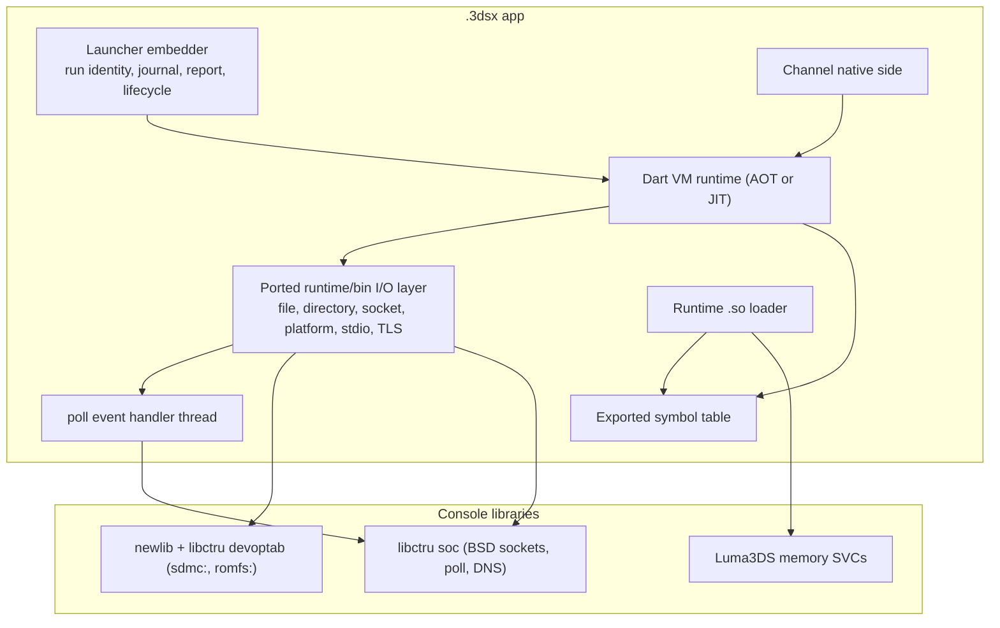
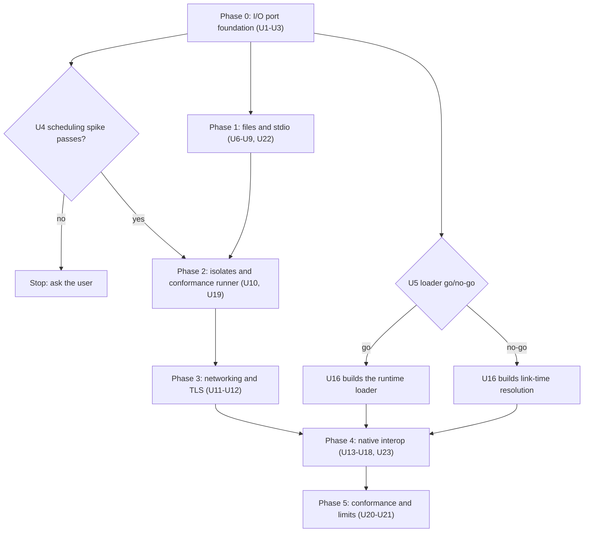
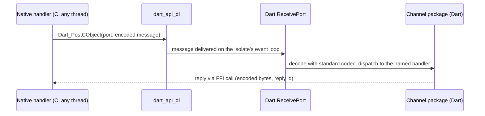

# Full Dart Compatibility on CTR - Plan

## Goal Capsule

- **Objective:** A developer can take ordinary Dart code and pub packages (files, networking, TLS, isolates, FFI and native packages) and run them on a New 3DS with dartbrew, and can call native console code from Dart. Every API that still cannot work fails with a documented, catchable error.
- **Means:** Port the Dart SDK's own I/O layer to CTR as a new host OS through SDK patches, extend the launcher into a full embedder (isolates, native interop), and add the native toolchain, loader and channel pieces dartbrew needs (KTD1, KTD4, KTD9).
- **Authority:** The Product Contract wins on behavior, and KTDs win on mechanism within it. Session-settled decisions (marked) are not reopened without new evidence. Where this plan and the code disagree about existing behavior, the code wins and the plan is corrected.
- **Execution profile:** An internal foundation phase, then five releasable phases (preview.5 to preview.9), each shipped as its own qualified preview release (Phased Delivery). Two spikes (U4, U5) gate later phases.
- **Stop conditions:** Stop and ask when the scheduling spike fails (thread scheduling cannot keep isolates responsive). A runtime-loader no-go does not stop the work; it switches U16 to the link-time fallback (Key Decisions). Also stop when a phase would need a public `dart:io` API addition, or when the app memory budget cannot hold a phase's feature set.
- **Who finishes:** Implementation and local qualification by the agent; publishing each preview needs the user's go-ahead, as with preview.4.

---

## Product Contract

### Summary

Bring the CTR target from "core language only" to full Dart compatibility through an internal foundation phase, then five releasable phases (preview.5 to preview.9):
- files and stdio;
- isolates;
- networking with TLS;
- native interop: FFI, callbacks, a runtime `.so` loader, build hooks and platform channels;
- upstream-suite conformance;
- documented limits.

Each phase ships as a dartbrew preview qualified on four hosts, a console and Azahar.

### Problem Frame

Today a Dart program on CTR works only within the core language and the `dart:core`, `dart:async` and `dart:collection` libraries. The launcher attaches a fallback resolver to `dart:io` (`runtime/ctr/source/unsupported.cc`), so every file, socket, stdio, `Platform` or `exit` call throws `UnsupportedError`. `Isolate.spawn` throws because the embedder has no isolate-creation callback. `DynamicLibrary.process()` throws (patch `0007-ctr-static-library-resolution.patch`), and dartbrew cannot compile or link a project's native code.

As a result most pub packages and most `package:test` suites cannot run on the console. Dart code also has no route to the console's own features. This milestone was settled as the step before hot reload and Flutter, and both depend on it: a hot-reload service needs sockets and isolates, and Flutter plugins need native interop.

### Requirements

**Files, stdio and process**
- R1. `File`, `Directory`, `FileSystemEntity`, `RandomAccessFile` and stat calls work on the SD card with the semantics of the Dart API on other platforms. `/` maps to the SD card root, and the working directory is the app's own folder.
- R2. A project can bundle read-only assets into its app, readable through `dart:io` under `romfs:/`.
- R3. `stdout` and `stderr` write to the existing output channel (screen, socket stream, journal). `stdin` reads the developer's terminal input when the app is launched by `dartbrew run` or `dartbrew test`, and the console's on-screen keyboard (one line per entry) when launched on the console alone. Ending terminal input or cancelling the keyboard is end-of-file.
- R4. `Platform` reports real values: `operatingSystem` is `ctr`, plus processor count, executable and script path, locale, version, an empty environment and a hostname.
- R5. `exit`, `exitCode`, `sleep` and `pid` work: `exit(n)` ends the app cleanly and `dartbrew run`/`test` report `n`.

**Networking**
- R6. TCP and UDP sockets (`Socket`, `ServerSocket`, `RawSocket`, `RawDatagramSocket`) work, including servers reachable from another machine on the network.
- R7. `InternetAddress` parsing and lookup (DNS) and `NetworkInterface.list` work.
- R8. `HttpClient`, `HttpServer` and `WebSocket` work, including compressed transfers.
- R9. `SecureSocket`, `SecureServerSocket` and `SecurityContext` work with a bundled root-certificate store. Apps can supply their own certificates.

**Isolates**
- R10. `Isolate.spawn`, `Isolate.run`, ports, messages, `Isolate.exit`, `kill`, error and exit listeners work in AOT and JIT.
- R11. `Isolate.spawnUri` works in JIT. In AOT it fails as it does on other AOT platforms.

**Native interop**
- R12. FFI calls into native code linked into the app work through `@Native` and `DynamicLibrary.process()`/`executable()`, including libctru and the project's own C/C++.
- R13. Native code can call back into Dart through `NativeCallable.isolateLocal` and `NativeCallable.listener`, including from native threads, and can post messages to Dart ports through the Dart API (`dart_api_dl`).
- R14. `DynamicLibrary.open` loads a native `.so` from the SD card at runtime on the console, resolves its imports against the app, and returns working symbols. If the loader proves infeasible (U5 no-go), `DynamicLibrary.open` instead resolves library names against native libraries linked into the app at build time (Key Decisions).
- R15. Packages with native build hooks (`package:hooks` code assets) build and link for CTR through dartbrew.
- R16. A platform-channel API in the style of Flutter's channels lets Dart and native handlers exchange named, asynchronous messages in both directions with a standard codec.
- R17. dartbrew compiles a project's C/C++ sources for CTR with tools bundled in the SDK, both for linking into the app and for producing loadable `.so` files.
- R24. Developers generate type-safe, synchronous Dart bindings to C headers for CTR with FFIgen: libctru headers and the project's own headers, through dartbrew with SDK-bundled tools. Generated bindings are the primary documented way to call console code; platform channels (R16) remain the compatibility layer.

**Library conformance and limits**
- R18. The remaining core libraries (`dart:convert`, `dart:typed_data`, `dart:math`, `dart:collection`, `dart:async`, zones and timers, `dart:developer`) behave as specified, or their CTR differences are documented.
- R19. The relevant upstream Dart SDK test suites pass on the console with a recorded list of known exceptions. Each exception cites one category: an API unsupported by design (R21), an item outside Scope Boundaries, an Azahar limitation (R22) or a measured resource limit (R20). Any other failure is a defect that blocks the phase release.
- R20. Resource limits are measured and documented: memory, threads and isolate count. Exhausting them fails catchably (`OutOfMemoryError`, isolate spawn errors), not with a crash.
- R21. APIs that cannot be supported keep failing with a catchable error that names the API: processes, file watching, links on FAT, mirrors in AOT. They are listed in `docs/ctr-supported-features.md`.

**Delivery**
- R22. Every phase works in AOT and JIT on the console, and in AOT in Azahar except where Azahar cannot provide a feature (JIT, the runtime loader).
- R23. Each phase ships as a qualified dartbrew preview release, with its results in `docs/qualification/<version>/results.json` and updated user docs.

### Key Decisions

- **Hot reload is the next milestone, and Flutter follows it.** This milestone stops at Dart compatibility. (session-settled: user-directed — chosen over building hot reload alongside it: compatibility first.) Governs R19, R23.
- **"Full compatibility" means upstream suites passing on device plus an exceptions list.** (session-settled: user-approved — chosen over a feature checklist: a checklist cannot show semantics match.) Governs R19, R21.
- **`DynamicLibrary.open` gets a real runtime loader, with link-time library resolution as the fallback plan if the loader proves infeasible.** (session-settled: user-directed — chosen over link-time-only resolution and over a loader with a runtime fallback layer.) Governs R14.
- **Native interop includes platform channels as well as FFI.** (session-settled: user-directed — the user extended "full compatibility" to calling native code through platform channels or native interop.) Governs R13, R16.
- **Direct native interop through FFIgen is the primary path; platform channels stay as the compatibility layer.** Follows Flutter 3.50's stable direct native interop. (session-settled: user-directed — chosen over keeping FFIgen for the follow-up only and over dropping channels.) Governs R16, R24.
- **Some APIs stay unsupported by design.** Processes and file watching have no 3DS homebrew equivalent. (session-settled: user-approved — chosen over emulating them with fake implementations.) Governs R21.

### Success Criteria

- The snake project's `test/io_test.dart`, which reads a file and fails today, passes on the console.
- A pub-based sample using `package:http` over HTTPS, a `shelf` server reached from the PC, and an isolate pool runs unchanged on the console.
- A sample using an FFI package through build hooks runs unchanged on the console: SQLite via `package:sqlite3`, opened with `DynamicLibrary.open`. It loads as a `.so`, or, under the link-time fallback, from the library linked into the app.
- The final conformance report lists every failing upstream test against an entry in the exceptions list. There are no unexplained failures.

### Scope Boundaries

- Hot reload, the VM service and DevTools: next milestone.
- Flutter.
- Original 3DS models and other Nintendo targets.
- Console features beyond what this milestone's own work and tests need, such as graphics, audio, camera and Mii data. These come through the follow-up FFI package below.
- File watching (`FileSystemEntity.watch`) is considered and not built. The SD card filesystem gives no change notifications, and a polling imitation would misreport timing. Evidence that would change this: an OS notification facility on the console.
- Processes (`Process.run`/`start`, signals) are considered and not built. A homebrew app cannot start another program.
- Symbolic links: the SD card's FAT filesystem has none, so `Link` operations fail catchably.
- `dart:mirrors` in JIT is considered and not built for this milestone. The standalone VM supports mirrors only in JIT, and almost no current packages need it. Evidence that would change this: a needed package that requires mirrors.

#### Deferred to Follow-Up Work

- **A Dart FFI package covering all homebrew libraries and their native functions:** libctru, citro2d, citro3d and the other devkitPro portlibs, generated with FFIgen (U23) from their headers and published for apps.
- Runtime loader extras beyond R14's core: thread-local storage in loaded libraries, unloading, and C++ exception handling across the boundary.
- Signing and macOS notarization of SDK builds.
- Restoring CI builds once GitHub Actions billing is fixed.

---

## Planning Contract

### Key Technical Decisions

- KTD1. **Port `runtime/bin` to CTR as a new host OS rather than writing `dart:io` natives in the launcher.** Add `*_ctr.cc` variants and `DART_HOST_OS_CTR` branches beside the Linux, macOS, Fuchsia and Windows ones, as new SDK patches. The upstream Dart code of `dart:io` then runs unchanged, and conformance tests exercise the real implementation. (session-settled: user-directed — chosen over launcher-side shortcuts: "do it right rather than a quick win that becomes dead code", from the `Uri.base` work.)
- KTD2. **Build the OS layer on newlib with libctru's devoptab and `soc` service.** libctru provides POSIX file calls on `sdmc:` and `romfs:`, BSD sockets, `poll`, `getaddrinfo` and `fcntl`. So most code can follow the shared `*_posix.cc` paths and the Linux variants. CTR files branch only where the console differs: no symlinks, no processes, no `epoll`/`eventfd`/pipes, no IPv6 and no `getifaddrs`.
- KTD3. **The event handler is `poll`-based.** It wakes through a loopback UDP socket the handler owns, because `soc` has no pipes or `eventfd`. If loopback wake-ups prove unreliable on the console or in Azahar, use a bounded `poll` timeout as the fallback. The choice is confirmed in U2's console checks.
- KTD4. **The launcher stays the embedder; it does not switch to `runtime/bin/main.cc`.** It links the ported I/O library, registers its natives and starts the event handler. It adds isolate-group creation and initialization callbacks. The launcher keeps its run identity, journal, socket report and app lifecycle, which dartbrew's run contract depends on. `stdout`/`stderr` are routed into the existing output records (R3).
- KTD5. **`Platform.operatingSystem` is `ctr`, with no new public `dart:io` getter.** Adding `Platform.isCtr` would change public API and fork the SDK surface. Packages branching on `isLinux` and the like take their default path. dartbrew docs state the value.
- KTD6. **Path model:** `/` is the SD card root, and `Directory.current` starts at the app's folder. Once `dart:io` is ported, `Uri.base` comes from `dart:io`'s own hook (derived from `Directory.current`, as on other platforms), replacing patch 0033's constant `file:///`. `romfs:/` paths reach bundled assets. The port treats `romfs:/` and `sdmc:/` prefixes as absolute in `dart:io` path handling, and `sdmc:/…` is normalized to `/…`.
- KTD7. **TLS uses the SDK's BoringSSL**, built for ARMv6K without assembly and seeded from the console's hardware RNG (`PS_GenerateRandomBytes`), plus a bundled Mozilla root store. (session-settled: user-approved — chosen over the console's `sslc` service: same behavior as other Dart platforms, at a memory and size cost.)
- KTD8. **Isolates share the app's isolate group.** `Isolate.spawn` uses the group's initialize callback, so AOT needs no second snapshot. `spawnUri` creates a new group from kernel in JIT only (R11).
- KTD9. **Runtime loader first, link-time resolution as the fallback plan (R14).** The loader maps an ELF shared object built by dartbrew. It applies ARM relocations, resolves undefined symbols against the app's exported symbol table, runs initializers and marks code executable through the same Luma3DS memory path the JIT uses (patch 0009). U5's go/no-go decides whether U16 builds the loader or the fallback. (Inherits the session-settled loader decision; governs R14.)
- KTD10. **The SDK bundles a C/C++ compiler for CTR (LLVM clang) with libctru, newlib and libstdc++ headers.** The alternative is requiring users to install devkitPro, and the SDK must stay self-contained. Branded devkitARM tools are not redistributed (`docs/ctr-native-sdk.md`). Clang is pinned like the existing binutils and built by the local producers.
- KTD11. **The app exports a generated symbol table.** dartbrew's link step generates a table of exported native symbols:
  - those named by `@Native` in the kernel;
  - those of project and hook-built libraries;
  - every undefined symbol of each `.so` dartbrew builds or packages for the app, read from the built objects before the final link;
  - a fixed C runtime baseline (newlib libc and libm, pthread, and the libgcc `__aeabi_*` helpers the ARM11 needs for division);
  - an explicit export list.

  `DynamicLibrary.process()` lookups and the runtime loader's import resolution both use it. Listing only these keeps `--gc-sections` effective for everything else and the app small.
- KTD12. **dartbrew runs build hooks itself**, the way `flutter_tools` does. It passes a code config with the bundled CTR compiler and the preferred link mode. Dynamic link mode builds loadable `.so` files once U16 ships the loader; static linking is used otherwise. The exact target identity `package:hooks` accepts for a non-standard OS is settled in U17 against the pinned SDK's hooks version (Open Questions).
- KTD13. **Platform channels are a dartbrew-shipped pure-Dart package plus a C header.** The codec follows the wire format of Flutter's `StandardMessageCodec`, so later Flutter plugins can share message formats. Dart-to-native calls use FFI. Native-to-Dart messages and replies use `Dart_PostCObject` through `dart_api_dl` (U15).
- KTD14. **Each area is its own SDK patch, numbered from 0034, recorded in `toolchain/versions.json`.** Every patch changes the SDK hash, so each preview rebuilds host tools on all four hosts with the local producers used for preview.4.
- KTD15. **Thread placement and priorities are decided by U4's spike, before isolates or the event handler depend on them.** The console scheduler does not time-slice threads of equal priority, so a busy isolate could starve the others and the event handler.
- KTD17. **FFIgen runs with libclang bundled in the SDK and a dartbrew-supplied CTR configuration.** The libclang shared library comes from the same pinned LLVM release as the bundled clang (U13). dartbrew supplies the target triple, flags and SDK header paths from the same native compiler configuration the build uses, so generated bindings match compiled code. (Inherits the direct-interop Key Decision; governs R24.)
- KTD16. **Conformance runs upstream test files batched into few apps.** One app per test is too slow to upload. Batched apps report per test, with a CTR status file of expected failures. Azahar runs the AOT corpus for throughput, and the console runs the full corpus in AOT and JIT before each phase release.

### High-Level Technical Design

Runtime architecture after the port. The launcher stays the embedder (KTD4) and links the ported I/O layer (KTD1) on top of libctru (KTD2).

Phase gating. Both spikes decide before the work that depends on them starts.

Native-to-Dart channel message flow (KTD13).

### Phased Delivery

| Phase | Units | Release | Ships |
| --- | --- | --- | --- |
| 0 | U1-U5 | none (internal) | I/O port foundation, event handler, embedder hooks, both spikes |
| 1 | U6-U9, U22 | preview.5 | Files, romfs assets, stdio, `Platform`, `exit`, feature qualification harness |
| 2 | U10, U19 | preview.6 | Isolates, upstream conformance runner |
| 3 | U11-U12 | preview.7 | Sockets, DNS, HTTP, WebSocket, TLS |
| 4 | U13-U18, U23 | preview.8 | C toolchain, FFI linking, callbacks, loader, hooks, channels, FFIgen bindings |
| 5 | U20-U21 | preview.9 | Final conformance report, remaining libraries, limits, final docs |

### Risks & Dependencies

| Risk | Mitigation |
| --- | --- |
| Equal-priority threads are not time-sliced, so a busy isolate starves others (KTD15) | U4 measures it first. Candidates: spreading mutators over cores 0 and 2, priority bands, VM safepoint yields. Stop condition if none works. |
| App memory (about 124 MB on New 3DS) cannot hold the VM, BoringSSL, several isolates and app data | U4 also records the memory baseline. U21 measures per-feature cost. Heap limits set by the launcher make exhaustion an `OutOfMemoryError`. |
| `soc` behaves differently on the console and in Azahar (poll edge cases, loopback, DNS) | Every networking test runs on both. Differences go into the exceptions list (R19). |
| The runtime loader needs Luma3DS memory permissions, unavailable in Azahar | The loader is console-only by design (R22). Linked-in native code keeps working in Azahar. |
| FFI callback trampolines need executable memory, which may not be granted in Azahar | U15 checks Azahar early. If unavailable, document callbacks as console-only in Azahar's column. |
| Every SDK patch changes the SDK hash, forcing four-host host-tool rebuilds per release | Accepted cost (KTD14). The local producers and Mac delegation from preview.4 are reused. |
| Thousands of upstream tests over the netloader are slow | Batching (KTD16), Azahar for bulk AOT runs, console for release qualification. |
| Bundled clang and headers raise license and size questions | U13 audits licenses: libctru zlib, newlib BSD-style, libstdc++ GPL with runtime exception, LLVM Apache-2.0. Notices are added to SDK notices. |

### Open Questions

- (Deferred to U17, non-blocking) Which target identity does the pinned SDK's `package:hooks`/`code_assets` accept for CTR: a custom OS value, or Linux plus a CTR extension in the config? Its OS enumeration currently names only Android, Fuchsia, iOS, Linux, macOS and Windows; verify against the pinned version.
- (Deferred to U4, non-blocking) Whether apps should request the console's extended memory mode, and how a `.3dsx` launched from Homebrew Launcher obtains it.

---

## Implementation Units

### Unit Index

| U-ID | Title | Key files | Depends on |
| --- | --- | --- | --- |
| U1 | Port runtime/bin build to CTR | `toolchain/patches/dart/0034-ctr-io-port.patch`, `toolchain/versions.json` | none |
| U2 | poll event handler | `toolchain/patches/dart/0035-ctr-eventhandler.patch` | U1 |
| U3 | Launcher links the I/O layer | `runtime/ctr/source/embedder.cc`, `runtime/ctr/source/unsupported.cc` | U1, U2 |
| U4 | Scheduling and memory spike | `docs/ctr-native-sdk.md` | U3 |
| U5 | Runtime loader go/no-go spike | `runtime/ctr/test/loader/` | none |
| U6 | Files and directories | `toolchain/patches/dart/0036-ctr-files.patch` | U3 |
| U7 | romfs assets | `packages/dartbrew/lib/src/targets/ctr/romfs.dart` | U6 |
| U8 | stdio, Platform, exit | `toolchain/patches/dart/0037-ctr-platform-stdio.patch`, `runtime/ctr/source/main.cc` | U3 |
| U9 | Phase 1 dartbrew, fixtures and docs | `test/programs/files.dart`, `docs/ctr-supported-features.md` | U6, U7, U8, U22 |
| U10 | Isolates | `runtime/ctr/source/embedder.cc` | U4, U3 |
| U11 | Sockets and DNS | `toolchain/patches/dart/0038-ctr-sockets.patch`, `runtime/ctr/source/link.cc` | U2, U4 |
| U12 | TLS, HTTP and WebSocket | `toolchain/patches/dart/0039-ctr-boringssl.patch`, `release/licenses/` | U11 |
| U13 | Bundled C/C++ toolchain | `release/native_clang.py`, `release/build_native_sdk.py` | none |
| U14 | Static native linking and symbol table | `packages/dartbrew/lib/src/targets/ctr/pipeline.dart` | U13 |
| U15 | FFI callbacks and Dart API DL | `toolchain/patches/dart/0041-ctr-ffi-callbacks.patch` | U14 |
| U16 | Runtime loader (or fallback) | `runtime/ctr/source/loader.cc` | U5, U14 |
| U17 | Build hooks | `packages/dartbrew/lib/src/targets/ctr/hooks.dart` | U13, U14, U16 |
| U18 | Platform channels | `packages/dartbrew_channels/` | U15 |
| U19 | Upstream conformance runner | `tools/conformance/`, `runtime/ctr/test/ctr.status` | U9 |
| U20 | Remaining libraries audit | `test/programs/libraries.dart` | U19 |
| U21 | Resource limits and failure shapes | `runtime/ctr/source/embedder.cc`, `docs/ctr-supported-features.md` | U10, U12, U16 |
| U22 | Feature qualification harness | `release/check_release.py`, `docs/qualification/` | U3 |
| U23 | FFIgen bindings for CTR | `packages/dartbrew/lib/src/commands/ffigen.dart`, `release/native_clang.py` | U13, U14 |

### U1. Port runtime/bin build to CTR

**Goal:** The ported I/O library builds and links for the CTR target, with every area stubbed to its unsupported shape until its own unit fills it in.

**Requirements:** R21, R22

**Dependencies:** None

**Files:**
- `toolchain/patches/dart/0034-ctr-io-port.patch` (new): adds `DART_HOST_OS_CTR` to `runtime/bin` platform switches, `*_ctr.cc` skeletons and the GN target for the CTR toolchain.
- `toolchain/versions.json`: registers the patch and its hash.
- `toolchain/build_sdk.py`: builds the I/O library in both target graphs.
- `release/freeze_runtime.py`: exports the I/O library with the runtime assets.
- `toolchain/test/test_build_sdk.py`

**Approach:**
- Mirror how earlier patches added `DART_HOST_OS_CTR` (`0004-ctr-os-concurrency.patch`, `0016-ctr-native-symbols.patch`): one `*_ctr.cc` per area next to the Linux variant.
- Start every area as a variant that throws the same named error today's fallback resolver gives (R21), so the build is green before behavior lands.
- Leave out `secure_socket_filter.cc` until U12; use `secure_socket_unsupported.cc` meanwhile.

**Patterns to follow:** `toolchain/patches/dart/0004-ctr-os-concurrency.patch`; the per-OS file split in the SDK's `runtime/bin/io_impl_sources.gni`.

**Test scenarios:**
- The CTR target graphs (AOT and JIT) build with the I/O library linked and `freeze_runtime.py` exports it.
- A fresh SDK replay with the new patch reproduces the recorded SDK head.
- The host-VM check (`runtime/ctr/test/test_host_vm.py`) still passes the unsupported-API program with the same error texts.

**Verification:** Both target graphs link, the runtime freezes, and the existing hardware fixtures still pass.

### U2. poll event handler

**Goal:** A CTR event handler thread multiplexes sockets with `poll` and drives `dart:io`'s asynchronous operations and timers.

**Requirements:** R6, R8

**Dependencies:** U1

**Files:**
- `toolchain/patches/dart/0035-ctr-eventhandler.patch` (new): `runtime/bin/eventhandler_ctr.cc` and `.h`.
- `runtime/ctr/test/eventhandler_host_test.cc` (new, host build of the poll logic with fake sockets)

**Approach:**
- Follow the structure of `eventhandler_linux.cc`, replacing `epoll` with a `poll` set rebuilt on change and the wake-up with a loopback UDP socket (KTD3).
- Timeouts come from the handler's timer queue, as on Linux.
- The handler thread priority comes from U4 (KTD15). Until then, use the keepalive thread's 0x2F, the band known to stay responsive.

**Test scenarios:**
- Host test: a registered readable socket produces one read event, and an interrupt wakes a blocked `poll` within one cycle.
- Host test: a timer due in 50 ms fires once and is not re-armed.
- Host test: closing a socket while it is registered removes it without a stale event.
- Console: a `Timer` and a pending socket read both complete while the main isolate runs a CPU loop (with U4's placement).

**Verification:** Host tests pass; on the console, a timer-plus-socket fixture completes in AOT and JIT.

### U3. Launcher links the I/O layer

**Goal:** The launcher registers the ported I/O natives, starts the event handler and loads `dart:io` through the SDK's own setup, keeping its run contract.

**Requirements:** R3, R21, R22

**Dependencies:** U1, U2

**Files:**
- `runtime/ctr/source/embedder.cc`: native resolution from the I/O layer, event handler start and stop, isolate-group callbacks scaffold for U10.
- `runtime/ctr/source/unsupported.cc`: reduced to areas still unsupported (R21), or removed once the I/O layer reports them itself.
- `runtime/ctr/source/main.cc`: lifecycle order (socket link, event handler, isolate) and shutdown.
- `runtime/ctr/test/check_retention.dart`: retains the new entry points.
- `runtime/ctr/test/report_test.cc`

**Approach:**
- Keep run identity, the journal, the report socket and the keepalive exactly as the schema-2 launcher contract defines them (`docs/runbooks/ctr-runtime.md`).
- The I/O layer's `soc` use and the launcher's report socket share one `socInit`. Ownership moves to a single owner that both use (detail in U11).

**Patterns to follow:** the current resolver wiring in `runtime/ctr/source/embedder.cc` (`Dart_SetNativeResolver` on `dart:io`).

**Test scenarios:**
- Host-VM check: `unsupported_apis.dart` still produces the documented error shapes for areas not yet implemented.
- Console: hello, async, exceptions and gc_stress still pass in AOT and JIT, with unchanged journal records.
- Console: a run whose program never touches `dart:io` starts no slower than today (within measurement noise).

**Verification:** All existing fixtures pass on the console and in Azahar; journal validation (`runtime/ctr/results.py`) accepts every run.

### U4. Scheduling and memory spike

**Goal:** Decide thread placement and priorities so isolates, the event handler and VM helpers make progress together, and record the app memory baseline.

**Requirements:** R10, R20

**Dependencies:** U3

**Files:**
- `docs/ctr-native-sdk.md`: records the decision and measurements.
- `runtime/ctr/test/programs/scheduling_probe.dart` (new): busy isolates plus a timer heartbeat.

**Approach:**
- Measure a CPU-bound isolate beside a timer heartbeat and a socket echo under three candidates: core 0 only, cores 0 and 2, and priority bands with periodic safepoint yields.
- Record free app memory after VM start in AOT and JIT, and the extended-memory question (Open Questions).
- Record a full thread budget against the console's 32-thread allowance: startup threads, keepalive, timer worker, event handler, the VM's global worker pool, each isolate group's mutator pool, the I/O service pool, `NativeCallable` listeners and native threads. U1's patch sets the I/O service pool's concurrency for CTR from this budget (upstream it is 32).

**Execution note:** This is a spike. Its output is a recorded decision with measurements. Any production change it implies lands in U2, U3 or U10.

**Test scenarios:**
- With the chosen policy, the heartbeat stays under 100 ms jitter while two isolates run busy loops.
- The socket echo answers within 200 ms under the same load.

**Verification:** A decision is recorded with numbers. If no candidate meets both thresholds, stop (Goal Capsule).

### U5. Runtime loader go/no-go spike

**Goal:** Prove or rule out loading a dartbrew-built `.so` on the console: map it, relocate it, call into it and get a callback back.

**Requirements:** R14

**Dependencies:** None (runs in parallel with Phase 0)

**Files:**
- `runtime/ctr/test/loader/` (new): a minimal loader prototype, a sample shared object, and its build script.
- `docs/ctr-native-sdk.md`: records the go/no-go result.

**Approach:**
- Build the sample with `-shared -fPIC` for ARMv6K hard-float. Handle `R_ARM_RELATIVE`, `R_ARM_ABS32`, `R_ARM_GLOB_DAT` and `R_ARM_JUMP_SLOT`, resolve imports against a hand-written symbol table, run `.init_array`, and mark text executable through the patch 0009 memory path (KTD9).
- "Go" means: a function in the `.so` returns a value, and calls a function exported by the app, on the console in an AOT app.

**Execution note:** Spike code is a prototype. U16 rewrites it to production quality or replaces it with the fallback.

**Test scenarios:**
- The sample's `add(2, 3)` returns 5 when called through a function pointer from the prototype.
- The sample calls an app-exported `host_log` and the call is observed.
- A `.so` needing an unsupported relocation type fails with an error naming the type.

**Verification:** A recorded go or no-go. No-go switches U16 to link-time resolution (Key Decisions).

### U6. Files and directories

**Goal:** `dart:io` file and directory operations work on the SD card with the path model of KTD6.

**Requirements:** R1, R21

**Dependencies:** U3

**Files:**
- `toolchain/patches/dart/0036-ctr-files.patch` (new): `file_ctr.cc`, `directory_ctr.cc`, `namespace_ctr.cc`, `fdutils_ctr.cc`.
- `test/programs/files.dart` (new), `test/expected/files.txt` (new)

**Approach:**
- Follow `file_linux.cc` and `directory_linux.cc` over newlib calls.
- Map `/` to `sdmc:/`, and set the initial working directory to the app's folder taken from argv[0].
- `Link` operations and `FileSystemEntity.watch` throw `FileSystemException`/`UnsupportedError` naming the operation (R21).
- `Directory.systemTemp` is a dartbrew temp folder on the SD card, cleared at app start.

**Test scenarios:**
- Write, read back, append and truncate a file under the app folder; contents and lengths match.
- `Directory.list` recursive over a created tree returns every entry with the right types.
- `rename` across folders and `delete(recursive: true)` leave no files behind.
- `stat` on a missing path returns type `notFound`; `File('/missing').readAsStringSync()` throws `PathNotFoundException`.
- `Link('/x').createSync('/y')` throws a catchable error naming links as unsupported.
- `RandomAccessFile` positional read and write at offsets 0, mid-file and end.
- 40 concurrent asynchronous file reads (`Future.wait`) all complete without hanging.
- A path given as `sdmc:/3ds/...` and as `/3ds/...` resolves to the same file.
- `Uri.base.resolve('x').toFilePath()` equals `File('x').absolute.path`.

**Verification:** `files.dart` passes on the console (AOT and JIT) and in Azahar; snake's `test/io_test.dart` passes.

### U7. romfs assets

**Goal:** dartbrew bundles declared assets into the app's romfs, and the app reads them under `romfs:/`.

**Requirements:** R2

**Dependencies:** U6

**Files:**
- `packages/dartbrew/lib/src/targets/ctr/romfs.dart` (new): builds a romfs image from an asset list.
- `packages/dartbrew/lib/src/targets/ctr/native_elf.dart`: appends romfs to the `.3dsx` with the extended header.
- `packages/dartbrew/lib/src/targets/ctr/pipeline.dart`
- `runtime/ctr/source/main.cc`: `romfsMountSelf` at start when the app carries romfs.
- `packages/dartbrew/test/romfs_test.dart` (new)

**Approach:**
- Assets are declared in a dartbrew section of `pubspec.yaml` (directories or files, project-relative).
- The romfs layout follows the documented format; no devkitPro tool code is copied (as with the 3DSX encoder, `docs/ctr-native-sdk.md`).

**Test scenarios:**
- An asset list with nested folders produces an image whose directory and file tables list every entry.
- An empty asset list produces no romfs and an unchanged `.3dsx`.
- A missing declared asset fails `dartbrew compile` naming the path.
- Console: the app reads `romfs:/data/hello.txt` and gets its bytes; writing under `romfs:/` throws a read-only `FileSystemException`.
- `File('romfs:/data/hello.txt').absolute.path` is unchanged, and reading through `.absolute` returns the asset bytes.

**Verification:** Unit tests pass; the asset fixture passes on the console and in Azahar.

### U8. stdio, Platform and exit

**Goal:** stdio, `Platform` and process-level calls behave as R3-R5 describe.

**Requirements:** R3, R4, R5, R21

**Dependencies:** U3

**Files:**
- `toolchain/patches/dart/0037-ctr-platform-stdio.patch` (new): `platform_ctr.cc`, `stdio_ctr.cc`, `process_ctr.cc` (exit, pid, unsupported process APIs).
- `runtime/ctr/source/main.cc` and `runtime/ctr/source/report.cc`: `exit(n)` ends the run with a terminal record carrying `n`.
- `packages/dartbrew/lib/src/device/verdict.dart`: maps the reported exit code.
- `test/programs/platform.dart` (new), `test/expected/platform.txt` (new)
- `runtime/ctr/test/test_results.py`, `runtime/ctr/test/verdict_vectors.json`
- `runtime/ctr/source/link.cc`: the report connection carries input from the host as well as output.
- `runtime/ctr/source/keyboard.cc` (new): line input through the system software keyboard applet.
- `packages/dartbrew/lib/src/device/device.dart`: `run` and `test` forward the terminal's stdin to the app.
- `docs/runbooks/ctr-runtime.md`: the launcher contract gains the input direction.

**Approach:**
- `stdout`/`stderr` writes become `output` records through the launcher (KTD4).
- `stdin` reads from the host connection when one exists, and from the software keyboard otherwise (R3). The keyboard opens only when the program reads, so programs that never touch `stdin` see no change.
- `Platform.localeName` comes from the system language (CFG service), `numberOfProcessors` from the cores available to the app, and `executable` from argv[0].
- `exit(n)` runs the launcher's normal cleanup and terminal path. A clean `exit(0)` is a pass; any other code is a fail carrying the code.

**Test scenarios:**
- `stdout.write` and `stderr.writeln` text arrives in order with `print` output.
- Under `dartbrew run`, two lines typed in the terminal arrive on `stdin` in order, and closing terminal input ends the stream.
- Launched standalone, reading a line opens the software keyboard and returns the entered text; cancelling ends the stream.
- A program that never reads `stdin` never opens the keyboard.
- `Platform.operatingSystem` is `ctr` and `Platform.environment` is empty.
- `exit(3)` ends the app; `dartbrew run` exits 3 and the journal shows cleanup then terminal.
- `exit(0)` after pending timers ends the app without running them.
- `sleep(Duration(milliseconds: 200))` blocks the isolate for at least 200 ms.
- `Process.run('ls', [])` throws a catchable error naming processes as unsupported.

**Verification:** `platform.dart` passes on the console and in Azahar; verdict vectors cover exit codes.

### U9. Phase 1 dartbrew, fixtures and docs

**Goal:** dartbrew, its templates and the docs reflect working files and stdio; Phase 1 qualifies as preview.5.

**Requirements:** R21, R22, R23

**Dependencies:** U6, U7, U8, U22

**Files:**
- `packages/dartbrew/lib/src/test_runner/classify.dart`: drop rules for areas that now work.
- `packages/dartbrew/lib/src/targets/ctr/templates.dart`: template shows an asset read.
- `docs/ctr-supported-features.md`, `release/README.md`, `README.md`
- `test/programs/unsupported_apis.dart`: trimmed to areas still unsupported.
- `packages/dartbrew/test/test_reporter_test.dart`, `packages/dartbrew/test/create_test.dart`

**Test scenarios:**
- A failing test that reads a missing file reports `PathNotFoundException`, not an unsupported-area classification.
- A freshly created project builds, runs and passes `dartbrew test` on the console and in Azahar.

**Verification:** preview.5 qualifies through U22's harness and `release/check_release.py`.

### U10. Isolates

**Goal:** Public isolates work as R10-R11 describe.

**Requirements:** R10, R11, R20

**Dependencies:** U3, U4

**Files:**
- `runtime/ctr/source/embedder.cc`: isolate group create and initialize callbacks, per-isolate data, shutdown and cleanup callbacks.
- `toolchain/patches/dart/0040-ctr-isolates.patch` (new, only if VM changes are needed for thread placement from U4)
- `test/programs/isolates.dart` (new), `test/expected/isolates.txt` (new)

**Approach:**
- Same-group spawn per KTD8.
- Thread placement per U4 (KTD15).
- An isolate spawn that would exceed the thread or memory budget fails with an `IsolateSpawnException`, not a crash (R20).

**Test scenarios:**
- `Isolate.run` returns a computed value; an exception inside it surfaces in the caller with its stack trace.
- Ten isolates exchange messages over `SendPort`s and all finish.
- `Isolate.exit` transfers a large list without copying, and the receiver sees it.
- `kill(priority: immediate)` stops a busy isolate, and the exit listener fires.
- JIT: `spawnUri` of a kernel file on the SD card runs it; AOT: `spawnUri` fails with the standard unsupported error.
- Spawning until the budget is exhausted yields a catchable `IsolateSpawnException`, and the app keeps running.

**Verification:** `isolates.dart` passes in AOT and JIT on the console and AOT in Azahar; U4's heartbeat stays within its threshold during the fixture.

### U11. Sockets and DNS

**Goal:** TCP, UDP, server sockets, address lookup and interface listing work over `soc`.

**Requirements:** R6, R7

**Dependencies:** U2, U4

**Files:**
- `toolchain/patches/dart/0038-ctr-sockets.patch` (new): `socket_ctr.cc`, `socket_base_ctr.cc`, `sync_socket_ctr.cc`.
- `runtime/ctr/source/link.cc`: one owner of `socInit` and its 0x1000-aligned buffer, shared with the I/O layer; buffer size revisited for server use.
- `test/programs/sockets.dart` (new), `test/expected/sockets.txt` (new)
- `release/test/test_native_sdk_integration.py`: host-side echo peer for the socket fixture.

**Approach:**
- Follow `socket_base_posix.cc`, branching where `soc` lacks options. Missing options fail per call with an `OSError`, as other platforms do for unsupported options.
- The address model is IPv4-only: IPv6 addresses and binds fail per call with `SocketException`, and IPv6 upstream tests go to `ctr.status`.
- `NetworkInterface.list` reports the console's single Wi-Fi interface from `soc`'s IP information.

**Test scenarios:**
- Connect to a host-side echo server, send 64 KiB and receive the same bytes.
- A `ServerSocket` on the console accepts a connection from the PC and reads a line.
- A UDP datagram round-trip with the PC.
- `InternetAddress.lookup('localhost')` and a public name both resolve; an unknown name throws `SocketException`.
- Connecting to a closed port fails with a refused `SocketException` within the timeout.
- Closing the socket from the PC side delivers a done event on the console.
- Binding `InternetAddress.anyIPv6` throws a catchable `SocketException`.

**Verification:** `sockets.dart` passes on the console (AOT and JIT) and in Azahar against the dartbrew host peer.

### U12. TLS, HTTP and WebSocket

**Goal:** Secure sockets work with bundled roots, and the pure-Dart HTTP and WebSocket stacks work over them.

**Requirements:** R8, R9

**Dependencies:** U11

**Files:**
- `toolchain/patches/dart/0039-ctr-boringssl.patch` (new): BoringSSL GN build for CTR without assembly, entropy from `PS_GenerateRandomBytes`, `security_context_ctr.cc` loading the bundled store, `secure_socket_filter.cc` enabled.
- `release/freeze_runtime.py`: exports the root store with the runtime assets.
- `release/licenses/`: BoringSSL and Mozilla root store notices.
- `test/programs/net_http.dart` (new), `test/expected/net_http.txt` (new)

**Approach:**
- Follow KTD7. The root store is a pinned Mozilla bundle, refreshed with the SDK. `SecurityContext.defaultContext` loads it lazily on first use, so apps without TLS pay no memory.
- zlib comes from the SDK's third-party tree for compressed HTTP.

**Test scenarios:**
- `HttpClient` GET over HTTPS to a public site returns 200 and a body.
- A certificate signed by an unknown CA fails with `HandshakeException`; with that CA added to a `SecurityContext`, it succeeds.
- `HttpServer` on the console serves a request from the PC, including a gzip-compressed response.
- A `WebSocket` echo round-trip with a host peer.
- A TLS connection survives a 30-second idle period without being dropped by the client.

**Verification:** `net_http.dart` passes on the console and in Azahar; memory cost of the first TLS connection is recorded for U21.

### U13. Bundled C/C++ toolchain

**Goal:** The SDK contains a pinned clang and the target headers and libraries needed to compile C/C++ for CTR on all four hosts.

**Requirements:** R17

**Dependencies:** None

**Files:**
- `release/native_clang.py` (new): producer for a trimmed clang per host, mirroring `release/native_binutils.py`.
- `release/clang-source.json` (new): pinned source and hashes.
- `release/build_native_sdk.py` and `release/bundle_native_sdk.py`: include clang, headers and a CTR target config.
- `release/licenses/`: LLVM, newlib, libctru and libstdc++ notices.
- `release/test/test_native_clang.py` (new)

**Approach:**
- Follow KTD10: one clang per host, built by the local producers.
- The CTR target profile in `toolchain/target-ctr.json` becomes the single source of compiler flags for both the runtime and user code.

**Test scenarios:**
- Each host's bundle compiles a C file calling `printf` and a C++ file using `std::vector` into ARMv6K hard-float objects the bundled linker accepts.
- The producer rejects a clang archive whose hash differs from the pin.
- `dartbrew doctor` verifies clang and the headers, and reports a missing header by name.

**Verification:** Producer tests pass and each host's SDK check compiles both samples.

### U14. Static native linking and symbol table

**Goal:** A project's native sources and libraries link into the app, and `@Native` and `DynamicLibrary.process()`/`executable()` resolve their symbols.

**Requirements:** R12, R17

**Dependencies:** U13

**Files:**
- `packages/dartbrew/lib/src/targets/ctr/pipeline.dart`: compile native sources, extract `@Native` symbols from the kernel, generate the export table, link.
- `packages/dartbrew/lib/src/targets/ctr/native_sources.dart` (new): finds and compiles project C/C++ sources.
- `toolchain/patches/dart/0007-ctr-static-library-resolution.patch` is superseded by a new patch resolving process and executable lookups through the exported table (KTD11).
- `packages/dartbrew/test/native_sources_test.dart` (new), `test/programs/ffi_static/` (new fixture project)

**Approach:**
- Native sources live in a conventional project folder declared in the dartbrew `pubspec.yaml` section.
- The export table lists `@Native` names, project symbols and an explicit export list (KTD11). Unlisted symbols stay subject to `--gc-sections`.

**Test scenarios:**
- A project with `src/add.c` and an `@Native` binding prints `add(2, 3) = 5` in AOT and JIT.
- `DynamicLibrary.process().lookup('add')` finds the same function.
- Looking up an unexported symbol throws `ArgumentError` naming it.
- A C compile error fails `dartbrew compile` and shows the compiler's message with file and line.
- A project with no native sources produces the same app as today.

**Verification:** The fixture passes on the console and in Azahar; app size for a project without native code is unchanged.

### U15. FFI callbacks and Dart API DL

**Goal:** Native code calls back into Dart, including from native threads, and posts messages to ports.

**Requirements:** R13

**Dependencies:** U14

**Files:**
- `toolchain/patches/dart/0041-ctr-ffi-callbacks.patch` (new, only if callback trampoline memory needs CTR changes)
- `runtime/ctr/source/embedder.cc`: exposes the Dart API DL entry points through the export table.
- `test/programs/ffi_callbacks/` (new fixture project with a native thread)

**Approach:**
- Callback trampolines use the VM's own allocation, which needs executable memory. Check Azahar first (Risks).
- `NativeApi.initializeApiDLData` works because the Dart API symbols are in the export table.

**Test scenarios:**
- A C function invokes an `isolateLocal` callback ten times synchronously, and Dart sees all ten.
- A native thread created with libctru calls a `listener` callback, and Dart receives the call on its event loop.
- Native code posts an integer array with `Dart_PostCObject_DL` to a `ReceivePort`, and Dart receives it intact.
- Calling a closed `NativeCallable` from native code does not crash the app.

**Verification:** The fixture passes in AOT and JIT on the console; Azahar's result is recorded either way.

### U16. Runtime loader (or fallback)

**Goal:** `DynamicLibrary.open` works per R14, built as the loader on U5 "go" or as link-time resolution on "no-go".

**Requirements:** R14

**Dependencies:** U5, U14

**Files:**
- `runtime/ctr/source/loader.cc` and `loader.h` (new): production loader per KTD9.
- `toolchain/patches/dart/0042-ctr-dynamic-library-open.patch` (new): routes `DynamicLibrary.open` on CTR to the launcher's loader.
- `packages/dartbrew/lib/src/targets/ctr/shared_library.dart` (new): builds `.so` files from project sources with the bundled toolchain (R17).
- `runtime/ctr/test/loader_test.cc` (new, host test with prebuilt sample objects)
- `test/programs/ffi_dynamic/` (new fixture project)

**Approach:**
- The library search order is: the path as given, the app folder, then `sdmc:/3ds/<app>/lib/`.
- Imports resolve against the export table (KTD11). An unresolved import fails the open with every missing symbol named.
- Without Luma3DS (Azahar), `open` fails with an error saying the loader needs Luma3DS.
- On "no-go": `open(name)` resolves `name` against libraries linked at build time, and the error for unknown names says which libraries were linked.

**Test scenarios:**
- Console: `DynamicLibrary.open('libsample.so')` then `lookup('add')` returns a working function.
- A `.so` calling an app-exported function and a libc function works.
- A `.so` that uses `malloc` and integer division loads, its imports resolving to the C runtime baseline.
- Opening a missing file throws `ArgumentError` naming every searched path.
- A `.so` with an unresolved import fails naming the symbol.
- A `.so` with thread-local storage fails naming TLS as unsupported (deferred extra).
- Azahar: `open` fails with the Luma3DS message, and linked-in `@Native` code still works in the same app.

**Verification:** Host loader tests pass; the fixture passes on the console in AOT and JIT.

### U17. Build hooks

**Goal:** Packages with `package:hooks` native build hooks build and link for CTR through dartbrew.

**Requirements:** R15

**Dependencies:** U13, U14, U16

**Files:**
- `packages/dartbrew/lib/src/targets/ctr/hooks.dart` (new): runs package hooks with the CTR code config (KTD12) and collects code assets.
- `packages/dartbrew/lib/src/targets/ctr/pipeline.dart`: links static assets, and packages dynamic ones into the app folder for U16.
- `packages/dartbrew/lib/src/targets/ctr/hook_defaults.dart` (new): dartbrew's table of CTR hook settings for known packages.
- `release/build_native_sdk.py`: bundles the pinned SQLite amalgamation (`sqlite3.c`) the sqlite3 entry points at.
- `packages/dartbrew/test/hooks_test.dart` (new), `test/programs/hooks_sqlite/` (new fixture project using `package:sqlite3` with no hook settings in its pubspec)

**Approach:**
- Resolve the target-identity question first (Open Questions).
- Hooks that ignore the provided compiler fail with a message naming the package.
- Many FFI packages' hooks download a prebuilt binary per OS instead of compiling (`package:sqlite3` does by default). dartbrew keeps a table of CTR hook settings for known packages and supplies them when building for CTR, so apps need no pubspec change. The first entry turns on sqlite3's build-from-source option (`source: source`) with the SDK's bundled `sqlite3.c`. Settings an app writes itself take precedence over the table.
- A package not in the table whose hook returns a downloaded prebuilt fails the build with a message naming the package and its source-build option, if it has one.

**Test scenarios:**
- A fixture package whose hook compiles one C file links statically and its `@Native` call works.
- The same package in dynamic mode produces a `.so` beside the app and loads through `DynamicLibrary.open`.
- `package:sqlite3` opens an in-memory database and runs a query on the console.
- A hook failure shows the hook's output and fails the build.
- `package:sqlite3` with no hook settings in the app's pubspec builds from source using the table entry, and its query runs on the console.
- An app that sets its own sqlite3 hook settings keeps them; the table entry is not applied.
- A hook not in the table that returns a downloaded prebuilt library fails the build naming the package and its source-build option.

**Verification:** The sqlite fixture passes on the console (Success Criteria).

### U18. Platform channels

**Goal:** Dart and native handlers exchange named, asynchronous messages through a channel API (R16).

**Requirements:** R16

**Dependencies:** U15

**Files:**
- `packages/dartbrew_channels/` (new package): Dart channel classes, standard codec, FFI transport.
- `packages/dartbrew_channels/native/dartbrew_channel.h` and `.c` (new): native registration, send and reply API.
- `packages/dartbrew_channels/test/codec_test.dart` (new), `packages/dartbrew_channels/test/channel_test.dart` (new)
- `packages/dartbrew/lib/src/targets/ctr/templates.dart`: optional template with a native channel handler.

**Approach:**
- Follow KTD13: method and basic message channels.
- The codec follows the `StandardMessageCodec` wire format; it is written fresh against the format, and Flutter code is credited if any is adopted (BSD-3).
- Native handlers may reply from any thread.
- Calling a channel with no handler completes with a `MissingPluginException`-style error.

**Test scenarios:**
- Codec round-trips null, bools, ints at 32/64-bit boundaries, doubles, strings, typed lists, nested lists and maps, byte for byte against recorded vectors.
- Dart `invokeMethod('add', [2, 3])` on a native handler returns 5.
- A native thread sends an event on a channel and a Dart handler receives it.
- Invoking a method with no native handler fails with the not-implemented error.
- A native handler error reply surfaces as a `PlatformException`-style error with code and message.

**Verification:** Package tests pass on the host; the channel fixture passes on the console in AOT and JIT.

### U19. Upstream conformance runner

**Goal:** Run the relevant upstream SDK test suites on the device in batches and produce a per-test report against a status file.

**Requirements:** R19

**Dependencies:** U9

**Files:**
- `tools/conformance/` (new): selects tests from the pinned SDK checkout, batches them into apps, collects per-test results.
- `runtime/ctr/test/ctr.status` (new): expected failures, each citing its R19 category and a reason.
- `docs/qualification/README.md`: adds how conformance results are recorded.
- `tools/conformance/test/` (new): batching and status-matching tests.

**Approach:**
- Suites: `tests/language`, `tests/corelib`, `tests/lib` (async, collection, convert, typed_data, math, isolate, ffi), and `tests/standalone` I/O tests that apply (KTD16).
- Multitests and tests needing their own process run one per app.
- Azahar runs the AOT batches; the console runs AOT and JIT for release.

**Test scenarios:**
- A batch of 50 passing tests reports 50 passes, and one deliberately failing test reports its name and failure.
- A test that crashes the app marks only that test and its batch remainder as incomplete, and the runner retries the remainder in a new batch.
- A failure matching a `ctr.status` entry is reported as expected; one not listed fails the run.
- A `ctr.status` entry that cites no R19 category, or an unknown one, is rejected and fails the run.

**Verification:** The runner produces a report for every selected suite on the console.

### U20. Remaining libraries audit

**Goal:** The libraries in R18 are checked on the device, and every CTR difference is fixed or documented.

**Requirements:** R18, R21

**Dependencies:** U19

**Files:**
- `test/programs/libraries.dart` (new), `test/expected/libraries.txt` (new)
- `docs/ctr-supported-features.md`
- `runtime/ctr/test/ctr.status`

**Approach:**
- `dart:developer` calls that need the VM service (`Service`, `postEvent` delivery) are no-ops that return as on a VM without a service, and `log`/`Timeline` are accepted without output. This is documented and revisited in the hot reload milestone.

**Test scenarios:**
- JSON and UTF-8 round-trips of large and malformed inputs match host results.
- `Random.secure()` produces bytes from the console RNG.
- Zone-scoped error handlers and `runZonedGuarded` catch async errors as on the host.
- `Timer.periodic` with a 1 ms period keeps ordering and does not starve the event loop.

**Verification:** Conformance failures in these libraries are fixed or listed in `ctr.status` with reasons.

### U21. Resource limits and failure shapes

**Goal:** Limits are measured and enforced so exhaustion fails catchably, and the final unsupported-API table is complete (R20, R21).

**Requirements:** R20, R21

**Dependencies:** U10, U12, U16

**Files:**
- `runtime/ctr/source/embedder.cc`: heap limits from the measured budget and isolate count limits.
- `test/programs/limits.dart` (new), `test/expected/limits.txt` (new)
- `test/programs/unsupported_apis.dart`: final table.
- `docs/ctr-supported-features.md`

**Test scenarios:**
- Allocating until exhaustion raises `OutOfMemoryError`, which is caught; the app then completes normally.
- Spawning isolates past the limit raises `IsolateSpawnException`.
- Each permanently unsupported API in R21 throws a catchable error naming it, in AOT and JIT.

**Verification:** The limits and unsupported fixtures pass; docs list measured numbers per mode.

### U22. Feature qualification harness

**Goal:** Release qualification records per-feature results for each preview, and the publish guard refuses a release whose features did not pass.

**Requirements:** R22, R23

**Dependencies:** U3

**Files:**
- `release/check_release.py`: also checks a `features` section of `results.json` for the version.
- `release/test/test_check_release.py`
- `docs/qualification/README.md` (new): how release and feature results are recorded.
- `.claude/skills/driving-ctr-console/SKILL.md`: notes for networking fixtures that need a host peer.

**Test scenarios:**
- `results.json` with every feature passing on its required environments is accepted.
- A feature with a failed console JIT result is refused, naming the feature and environment.
- A feature marked not applicable to Azahar (JIT, loader) does not require an Azahar result.

**Verification:** Guard tests pass, and preview.5 is the first release checked with features.

### U23. FFIgen bindings for CTR

**Goal:** Developers generate Dart bindings to libctru and project C headers with FFIgen for CTR, and call them synchronously from Dart (R24).

**Requirements:** R24

**Dependencies:** U13, U14

**Files:**
- `release/native_clang.py` and `release/clang-source.json`: the clang component also carries the libclang shared library from the same pinned LLVM release.
- `packages/dartbrew/lib/src/commands/ffigen.dart` (new): `dartbrew ffigen` runs the project's FFIgen with the bundled libclang and the CTR compiler options (KTD17).
- `packages/dartbrew/lib/src/cli.dart`: registers the command.
- `packages/dartbrew/lib/src/targets/ctr/templates.dart`: the native template uses generated bindings.
- `packages/dartbrew/test/ffigen_test.dart` (new), `test/programs/ffigen_libctru/` (new fixture project)
- `release/README.md`, `docs/ctr-supported-features.md`: generated bindings documented as the primary interop path.

**Approach:**
- FFIgen is the project's own dev dependency. dartbrew passes the libclang path and compiler options, and never edits the project's FFIgen config file.
- The CTR options come from the SDK's native compiler configuration (U13), so headers parse with the same type definitions the compiled code uses.
- Bindings resolve through `@Native` and the exported symbol table (U14), so they work in AOT and JIT and in Azahar.

**Test scenarios:**
- Generating bindings for libctru's `hid.h` produces Dart functions for `hidScanInput` and `hidKeysDown`, with the integer types of libctru's typedefs (for example `u32` as `Uint32`).
- On the console, the fixture calls `hidScanInput()` and `hidKeysDown()` synchronously through the generated bindings and prints the key state.
- A project header with a struct and an enum generates bindings whose struct size matches what the bundled compiler reports.
- A header with a syntax error fails `dartbrew ffigen`, showing libclang's message with file and line.

**Verification:** The fixture passes on the console in AOT and JIT and in Azahar; generated struct layouts match compiled layouts.

---

## Verification Contract

| Gate | Command or procedure | Applies to |
| --- | --- | --- |
| dartbrew unit tests | `dart analyze`, `dart format --set-exit-if-changed`, `dart test` in `packages/dartbrew` and `packages/dartbrew_channels`, run in the `ctr-dart-toolchain` container | Every unit touching Dart packages |
| Python suites | `python3 -m unittest discover -s toolchain/test`, `-s runtime/ctr/test`, `-s release/test` in the container | Every unit |
| SDK replay | Fresh bootstrap with the patch queue reproduces the head recorded in `toolchain/versions.json` (`CTR_SDK_INTEGRATION=1`) | U1, U2, U6, U8, U10-U12, U14-U16 |
| Launcher host tests | C++ host tests in `runtime/ctr/test` (report, event handler, loader) | U2, U3, U16 |
| Device fixtures | Each fixture in `test/programs` with its `test/expected` output, through `dartbrew run --verdict` on the console (AOT and JIT) and in Azahar (AOT), validated by `runtime/ctr/results.py` | Every feature unit |
| Conformance | `tools/conformance` report with no failures outside `runtime/ctr/test/ctr.status` | U19-U21, every phase release from preview.6 on |
| Release | Four-host bundles via `release/build_native_sdk.py`, then `release/check_release.py --results docs/qualification/<version>/results.json` | U9, U10, U12, U18, U21 phase ends |

## Definition of Done

- Each phase: its units' test scenarios pass, its fixtures pass on the required environments (R22), its preview is qualified and recorded, and publishing waits for the user.
- The milestone: all four Success Criteria hold, the conformance report has no unexplained failures, and `docs/ctr-supported-features.md` lists every unsupported API with its error shape.
- Spike code from U4 and U5 that did not become production code is removed. No abandoned-attempt code remains in the diff.
- Each new SDK patch is registered with its hash, replays from scratch, and is described in `docs/ctr-native-sdk.md`.

---

## Appendix

### Sources

- Current `dart:io` fallback: `runtime/ctr/source/unsupported.cc`, wired in `runtime/ctr/source/embedder.cc`.
- CTR as a host OS in the SDK: `toolchain/patches/dart/0004-ctr-os-concurrency.patch`, `0012-ctr-embedder-async.patch` (CTR platform includes all VM libraries), `0007-ctr-static-library-resolution.patch` (process lookups throw today), `0009-ctr-virtual-memory.patch` (Luma custom SVC check for executable memory), `0033-ctr-uri-base.patch`.
- SDK I/O layer per-OS split: the pinned checkout's `runtime/bin/io_impl_sources.gni` (Linux, macOS, Fuchsia and Windows variants, plus `secure_socket_unsupported.cc`), and `third_party/boringssl`, `third_party/zlib`.
- libctru: `poll.h`, `netdb.h` (`getaddrinfo`), `3ds/services/soc.h`, `3ds/romfs.h` (`romfsMountSelf`), `3ds/services/ps.h`.
- Launcher contract, journal and qualification: `docs/runbooks/ctr-runtime.md`, `docs/qualification/0.1.0-preview.4/results.json`, `release/check_release.py`.
- Azahar limits (no JIT; loader needs Luma3DS): `docs/ctr-supported-features.md`.
