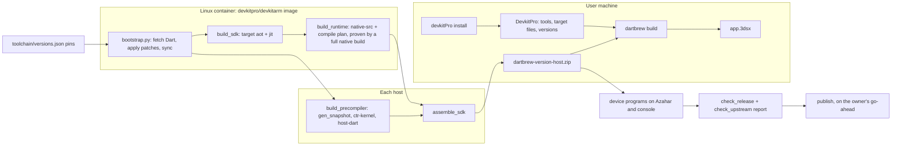
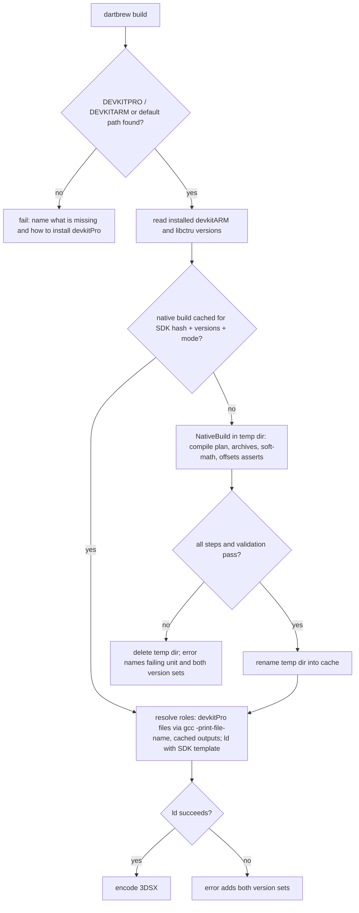
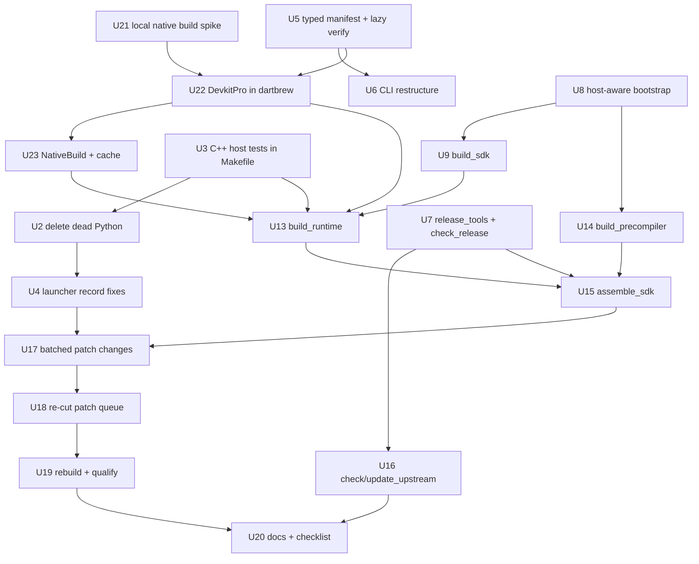

# Release Toolchain and Tooling Rewrite - Plan

## Goal Capsule

- **Objective:** A maintainer can produce, check and publish a dartbrew release for three hosts by following one checklist, and the SDK ships no compiled 3DS code. Users install devkitPro and dartbrew, and every native part of their app is compiled against the devkitPro they actually have, as the Rust 3DS port does.
- **Means:** dartbrew compiles the runtime, `dart:io` layer, launcher and soft-math from sources shipped in the SDK with the user's devkitARM, caches the result, and links against the user's libraries (KTD16, KTD18, KTD20); every post-bootstrap release step becomes a Dart executable in `packages/release_tools` (KTD6); dead Python is deleted; the maintainability audit is applied (R13-R16).
- **Authority:** The Product Contract wins on behavior, KTDs win on mechanism within it. Session-settled decisions are not reopened without new evidence. Where this plan and the code disagree about existing behavior, the code wins and the plan is corrected.
- **Execution profile:** A spike first proves the runtime compiles from a source bundle with a local devkitPro install on Windows, links, runs, and measures the first-build time (U21). CLI, launcher and Python cleanup run in parallel with the new release tools. Patch-queue changes may be built in the container as they land; the three-host precompiler rebuild and qualification happen once, in U19. Verification runs on Azahar as each unit lands; console checks are collected for a session when the console's network is stable.
- **Prerequisite:** Console verification of the uncommitted full-compatibility plan U6/U8 work (files, platform, exit codes, stdio) finishes and that work is committed before U21 starts.
- **Stop conditions:**
  - Stop and ask when U21 fails: the runtime cannot be compiled from the source bundle with the user's devkitPro and run hello AOT on Azahar.
  - Stop and ask when U21 measures a first build of one mode above 15 minutes on the Windows PC.
  - Stop and ask when a device test program regresses and the cause is not in our patches or build flags.
  - Stop and ask before anything is published.
- **Who finishes:** Implementation and local qualification by the agent. Mac builds need the user at the Mac. Publishing preview.5 needs the user's go-ahead and is not part of this plan.

---

## Product Contract

### Summary

dartbrew stops bundling a compiler, binutils, devkitPro's libraries and prebuilt runtime archives. Users install devkitPro; on the first build, dartbrew compiles the runtime, `dart:io` layer and launcher from sources in the SDK with the user's devkitARM, caches them, and links against the user's libraries, mirroring how the Rust 3DS port builds its standard library. The remaining release Python becomes seven Dart executables in `packages/release_tools`, only the Python bootstrap stays, and one checklist describes a release. The maintainability audit's findings and defect fixes are applied, and the macos-x64 host is dropped.

### Problem Frame

dartbrew releases are produced by about 6,500 lines of Python spread over `release/` and `toolchain/`. A large part exists to build clang and binutils from source on four hosts (the hardest part of preview.4) or to repair GitHub Actions artifact transport that local builds never need. Some of it is dead (`toolchain/package_runtime.py`), and some duplicates Dart code (`runtime/ctr/results.py` against `verdict.dart`).

The SDK also ships libgcc, libstdc++, newlib and libctru frozen from a devkitARM r68 install. devkitPro's maintainer objects to redistribution of devkitPro-built binaries and old versions, and says GPL binaries need corresponding source hosted by the distributor ([GBAtemp thread](https://gbatemp.net/threads/collection-of-old-devkitpro-versions.526377/)). Building those libraries ourselves would mean maintaining patches derived from devkitPro's. Every 3DS homebrew developer already has devkitPro installed, and Rust's 3DS target requires it too.

A maintainability audit (session 2026-11-22) found dead launcher fallbacks, three owners for run identity, a 707 MB SDK re-hashed on every command, link flags written in four places, and seven defects, among them long output lines turning a passing run into "incomplete". There is no single document describing how to produce a release.

### Requirements

**devkitPro**

- R1. dartbrew compiles every native 3DS part of an app (runtime, `dart:io` layer, launcher, soft-math) and links it with the user's devkitPro install (devkitARM and libctru), found through `DEVKITPRO`/`DEVKITARM` or the platform's default install location.
- R2. The SDK ships no compiled 3DS code, no devkitPro file and nothing derived from a devkitPro binary, and no shipped name uses the devkitPro or devkitARM names.
- R3. When devkitPro is missing, `doctor` and every build command fail with a message naming what is missing and how to install it.
- R4. Each release records the devkitARM and libctru versions it was qualified with; `doctor` shows them next to the installed versions, and a native compile or link failure names both.
- R18. The native build runs once per dartbrew version, devkitARM version, libctru version and mode, reports its progress, and is cached; an interrupted or failed build never leaves a cache entry later builds would use.
- R5. The SDK's notices and the credits for components it bundles are generated from the pin table, not edited by hand.
- R6. Supported hosts are windows-x64, linux-x64 and macos-arm64.

**Keeping current**

- R7. Every upstream component has exactly one pin entry.
- R8. At release time, a check reports newer devkitARM, libctru, Dart and other pinned versions without blocking the release.
- R9. A command bumps a pin and its hashes and regenerates notices.

**Release tooling**

- R10. Every release step after bootstrap is a named Dart executable in `packages/release_tools`.
- R11. The SDK checkout bootstrap stays Python and works on all three hosts; it is the only Python left in the release path.
- R12. `docs/releasing.md` is the single ordered release checklist, from bootstrap to publishing.

**Audit**

- R13. Dead code, dead workflows and duplicated implementations named by the audit are removed (audit #1-#5, #8, the cleanup list).
- R14. Decisions the audit found with several owners get one owner each (audit #6, #9-#11, #13-#18).
- R15. Defects D1-D7 are fixed; D4 is fixed only if a test confirms it.
- R16. The numeric golden tables run as a device test program instead of living in the SDK patch queue (audit #7), and the patch queue is re-cut with an identical final source tree (audit #12).

**Behavior preserved**

- R17. Apart from R15's fixes, `Platform.localHostname` returning `"ctr"`, and devkitPro becoming a prerequisite, existing programs behave the same: every program in `test/programs` passes on Azahar, and on the console before release.

### Key Decisions

- **Users install devkitPro; dartbrew tracks its current releases.** (session-settled: user-directed — chosen over a self-contained SDK built from Arm's toolchain and source-built libraries: maintaining patches derived from devkitPro's is not maintainable.) Governs R1, R2, R3, R4.
- **Mirror the Rust 3DS port: compile native parts on the user's machine.** (session-settled: user-directed — chosen over prebuilt runtime archives with version warnings, and over compiling only the launcher and `dart:io` layer locally: no version drift is possible, at the cost of a first build measured in minutes.) Governs R1, R2, R18.
- **Never refuse on an untested devkitPro version.** (session-settled: user-approved — devkitPro offers only its latest release, so refusing would leave users with no working setup.) Governs R4.
- **Drop macos-x64.** (session-settled: user-directed — chosen over restoring the fourth host: one fewer precompiler build per release, and Intel Macs are near the end of Apple's support.) Governs R6.
- **Release-time update checks only.** (session-settled: user-directed — chosen over a scheduled weekly check.) Governs R8.
- **Single-purpose executables in `packages/release_tools`.** (session-settled: user-directed — chosen over one "producer" tool, which was too vague.) Governs R10.
- **Python bootstrap stays.** (session-settled: user-approved — chosen over downloading a pinned Dart first.) Governs R11.
- **`docs/releasing.md` is the one release checklist.** (session-settled: user-directed.) Governs R12.
- **Numeric scripts deleted; goldens run on the device.** (session-settled: user-approved — chosen over a gated Dart rewrite: the scripts' value was spent writing the helpers.) Governs R16.
- **`Platform.localHostname` returns `"ctr"`.** (session-settled: user-approved — chosen over libctru's IP-address hostname and the console nickname.) Governs R17.

### Success Criteria

- A maintainer who has never produced a release can do it from `docs/releasing.md` alone.
- A user with a current devkitPro install and the SDK zip can build and run hello on Azahar with no other setup; the second build of a project starts as fast as builds do today.
- `git ls-files '*.py'` lists only `toolchain/bootstrap.py`, the verification part of `toolchain/common.py`, and their tests.

### Scope Boundaries

- Console verification of the full-compatibility plan's U6/U8 is a prerequisite, not part of this plan.
- New Dart compatibility work (full-compatibility plan U7 onward) is not part of this plan.
- Publishing preview.5 is not part of this plan.
- dartbrew keeps its own 3DSX encoder, SMDH writer and netloader client; it does not start using devkitPro's `3dsxtool`, `smdhtool` or `3dslink`.
- Not built: a prebuilt-runtime fallback for users who cannot wait for the first build (revisit if first-build time becomes a common complaint).
- Not built: a shared or downloadable native-build cache.
- Not built: GN or ninja on the user's machine; dartbrew runs the recorded compile plan itself (KTD20).
- Not built: a scheduled update check (R8 covers release time only).
- Not built: refusing to build on an untested devkitPro version.

#### Deferred to Follow-Up Work

- dartbrew compiling a project's own C code with the user's devkitARM gcc (full-compatibility plan U13, revised by U20).
- The homebrew FFI package; devkitPro's portlibs (citro2d, citro3d) come from the user's install.
- Deleting the loader spike `runtime/ctr/test/loader/` (full-compatibility plan U16 still uses it as reference).
- Process and RSS stubs reporting real values through `svcGetProcessInfo` (a behavior change outside R15 and R17; needs its own requirement and device test).
- Setting up boat.dev for heavy builds.

---

## Planning Contract

### Key Technical Decisions

- KTD6. **`packages/release_tools`: one unpublished package, seven executables.** Executables: `build_sdk`, `build_runtime`, `build_precompiler`, `assemble_sdk`, `check_upstream`, `update_upstream`, `check_release`. The approved set had nine; `fetch_toolchain` and `build_target_libraries` went with the switch to a devkitPro prerequisite. It depends on `packages/dartbrew` by path, runs with the SDK checkout's Dart (`<sdk>/tools/sdks/dart-sdk/bin/dart`, currently 3.14.0-226.0.dev), and keeps `environment.sdk: '>=3.11.0 <4.0.0'` so that dev build is accepted. A shared stage runner, generalized from `lib/src/stage_runner.dart`, records `commands.json` and per-stage logs. Hidden dartbrew commands were rejected: they would ship maintainer-only build logic in every user's binary. (session-settled: user-directed — chosen over one "producer" tool.)
- KTD7. **dartbrew's first public library, `package:dartbrew/sdk_manifest.dart`.** A typed `SdkManifest` (tools, runtime modes, compile plan, link plan, files, qualified devkitPro versions) that `assemble_sdk` writes and `NativeSdk` reads, replacing `Map<String, dynamic>`. U5 introduces it for today's shape. From U15 on, the link plan is a full ordered `ld` argument template whose inputs are named roles: devkitPro files (`crt0`, `crti`, `libctru`, `libc` and so on) that KTD16 resolves, and native-build outputs (`runtime`, `io`, `launcher`, `soft_math`) that KTD20 produces, so `pipeline.dart` and tests read one owner (audit #18). (Governs R14.)
- KTD8. **The pin table.** `toolchain/versions.json` holds one entry per upstream with version, URLs, SHA-256 values, licence files and a release-feed location: the devkitPro container image (by digest, with the devkitARM and libctru versions it contains), Dart, ICU and GN. `release/target-sources/SOURCES.json` and the binutils and clang pin files are deleted. (Governs R5, R7.)
- KTD10. **Build identity changes are expected.** Build identity hashes the whole target profile (`toolchain/common.py` `build_identity`). The Dart port only has to be deterministic, not byte-compatible with Python's keys, because the batched rebuild (U19) changes every key anyway.
- KTD12. **`check_upstream` sources.** GitHub's API for libctru releases and devkitARM releases (devkitPro `buildscripts` release commits), Docker Hub for the `devkitpro/devkitarm` image digest, and the Dart SDK. `check_release` prints the report and never fails on it. (session-settled: user-directed — release-time only; governs R8.)
- KTD13. **Long output lines are split by the launcher.** `report.cc` emits a stdout or stderr record whenever its buffer reaches a fixed chunk size, marking it as a continuation, so no record exceeds the host's 64 KiB line limit and device memory stays bounded. The chunk size lives in `runtime/ctr/source/report.h`. A long-line vector in `packages/dartbrew/test/data/verdict_vectors.json` is read by both `verdict_test.dart` and `runtime/ctr/test/report_test.cc`, so a change on either side fails a test. (Governs R15.)
- KTD14. **Python file fates follow the 2026-11-22 classification** (Appendix, Python inventory), with these corrections: `test_ctr_native_offsets.py` is a production step and moves into `build_runtime`; `test_toolchain.py`'s identity tests move to Dart with `build_sdk`; `test_host_vm.py` ports to a gated Dart test before `results.py` is deleted; `native_binutils.py`, `native_clang.py` and their producers are deleted outright rather than rewritten.
- KTD15. **FFIgen gets libclang from the user's LLVM install.** The homebrew FFI package ships pre-generated bindings, so most users never run FFIgen. (session-settled: user-directed — chosen over bundling libclang.) Recorded here because U20 rewrites the full-compatibility plan's KTD17 and U23 to match.
- KTD16. **One `DevkitPro` type in dartbrew owns finding and querying the install.** It resolves the install root from `DEVKITPRO`/`DEVKITARM`, then the default locations (`/opt/devkitpro`; `C:\devkitPro` on Windows, where `DEVKITPRO` is often an MSYS-style `/opt/devkitpro` that must map to the Windows root). It exposes the tools (`arm-none-eabi-as`, `-ld`, `-gcc`, `-g++`, `-objcopy`), resolves each target file by asking `arm-none-eabi-gcc <ctr cflags> -print-file-name=<name>` (the same query `freeze_runtime.py` uses today), and reports the installed versions: query `devkitARM` and `libctru` with `dkp-pacman -Q` or the bundled `pacman -Q`. Report unknown when a package version is unavailable. Nothing else in dartbrew builds a devkitPro path. (Governs R1, R3, R4.)
- KTD17. **Version policy.** `runtime.json`, and from it `sdk.json`, records the devkitARM release and libctru version the release was qualified with. `doctor` prints installed against qualified versions. Builds do not warn; when a native compile or `ld` fails, the error adds both version sets and "update dartbrew or devkitPro". (session-settled: user-approved — never refuse; governs R4.)
- KTD18. **Soft-math is part of the native build.** It is derived from devkitARM's soft-float `libm.a`, so it cannot ship (R2). The native build compiles `toolchain/soft_math_bridge.cc` (shipped as source), processes the user's `libm.a` with `objcopy` and `ld -r` from the user's devkitARM, and runs the existing symbol and attribute validation. The linker script and startup code (`3dsx.ld`, `3dsx_crt0.o`) come from the user's install; the repository copies in `release/target-sources/` are deleted. (Governs R1, R2.)
- KTD19. **The producer container stays devkitPro's official image.** `compose.yaml` keeps `devkitpro/devkitarm` pinned by digest in `toolchain/versions.json`; using devkitPro's own distribution channel is not redistribution. The container builds the patched SDK, generates the compile plan, and proves it with a full native build and probe link before release. (Governs R2.)
- KTD20. **The native build: a source bundle plus a recorded compile plan, run by dartbrew.**
  - **What ships:** `native-src/` in the SDK holds the sources and headers the CTR runtime, `dart:io` layer and launcher compile from (taken from the patched checkout, about 430 source files for AOT plus JIT and launcher sources), the generated sources, and `soft_math_bridge.cc`. `compile-plan.json` holds, per mode, each translation unit with its exact flags (captured from ninja at release time, compiler and paths replaced by placeholders) and how objects group into archives.
  - **How it runs:** a `NativeBuild` operation in dartbrew substitutes the user's devkitARM tools from `DevkitPro`, runs the compiles in parallel (one job per core, response files for long command lines on Windows), archives with `arm-none-eabi-ar`, and builds soft-math (KTD18). It drops `-Werror` so a newer gcc's new warnings do not fail users' builds.
  - **The struct-layout check:** the VM's offsets check, which `freeze_runtime.py` runs today, becomes a translation unit of `static_assert`s in the plan, so a compiler whose layout differs from what `gen_snapshot` assumes fails the build with the offsets named.
  - **Cache and lifecycle:** outputs live under the user's dartbrew cache, keyed by the SDK manifest hash, devkitARM version, libctru version and mode. `NativeBuild` builds into a temporary directory and renames it into place only after every step and the validation succeed, and deletes the temporary directory on failure or cancellation, so a partial build is never reused (R18).
  - **Progress:** one line per phase plus a count of compiled units, through the existing progress output. (Governs R1, R2, R18.)

### High-Level Technical Design

Release and build flow after this plan. Boxes in the container run once per release; boxes per host run on windows-x64, linux-x64 and macos-arm64; the bottom row runs on the user's machine.

How `dartbrew build` gets its native inputs (KTD16, KTD18, KTD20):

Unit dependencies. Units run in any order their arrows allow; U17-U19 land together and end in the one three-host rebuild.

### Risks & Dependencies

| Risk | Mitigation |
|---|---|
| First native build is too slow for users | U21 measures it and has a stop threshold; parallel compiles and the cache keep it a one-time cost per version |
| A new devkitARM gcc rejects runtime sources (new errors, not warnings) | `-Werror` is dropped (KTD20); `check_upstream` reports new devkitARM releases at release time; the error names the failing unit and versions |
| A new libctru changes an API the launcher or `dart:io` layer uses, so compiling fails | Same as above: the failure is loud and immediate, never a silent mismatch; a dartbrew update follows |
| Windows command lines exceed the length limit for long compile commands | KTD20 uses response files; U21 runs on Windows first |
| The user's gcc lays out VM structs differently from what `gen_snapshot` assumes | The offsets `static_assert` unit fails the build, naming the offsets (KTD20) |
| Cache grows with each dartbrew and devkitPro version | `doctor --clean-cache` is not built; entries are in one documented directory the user can delete (revisit if reported) |
| Windows installs set `DEVKITPRO` to an MSYS path | KTD16 maps it to the Windows root; U22 tests both forms |
| `dkp-pacman` is absent (some Linux installs use the distribution's `pacman`) | KTD16 falls back to `pacman`, then reports the version as unknown with a warning |
| Building soft-math on the user's machine fails on a new devkitARM | The validation names the failing symbol or attribute; the build stops with the devkitARM version in the message |
| An interrupted build leaves a half-written cache entry | KTD20 builds in a temporary directory and publishes by rename only on success |

---

## Implementation Units

### Implementation status at U21

U2 through U9, U14 and U16 are committed. U21 passed the Windows AOT spike below. U22 and U23 are next, followed by U13 and U15 for SDK assembly, U17 and U18 for the patch queue, and U19 and U20 for qualification and documentation. The Windows spike qualifies one hello build. Three-host SDK and physical-console qualification remain open.

### Unit Index

| U-ID | Title | Key files | Depends on |
|---|---|---|---|
| U21 | Local native build spike | scratch only | prerequisite |
| U22 | `DevkitPro` in dartbrew | `packages/dartbrew/lib/src/devkitpro.dart`, `pipeline.dart`, `doctor.dart` | U5, U21 |
| U23 | `NativeBuild` and its cache | `packages/dartbrew/lib/src/targets/ctr/native_build.dart` | U22 |
| U2 | Delete dead Python and Actions plumbing | `release/`, `toolchain/`, `runtime/ctr/`, `.github/workflows/` | U3 |
| U3 | C++ host tests in the Makefile | `runtime/ctr/Makefile`, `.github/workflows/ci.yml` | none |
| U4 | Launcher record and boundary fixes | `runtime/ctr/source/report.*`, `main.cc`, `sync.h` | U2 |
| U5 | Typed SDK manifest and lazy verification | `packages/dartbrew/lib/sdk_manifest.dart`, `lib/src/sdk.dart` | none |
| U6 | CLI restructure | `lib/src/commands/`, `lib/src/device/`, `lib/src/targets/` | U5 |
| U7 | `release_tools` package and `check_release` | `packages/release_tools/` | none |
| U8 | Host-aware Python bootstrap | `toolchain/bootstrap.py`, `toolchain/common.py`, `toolchain/versions.json` | none |
| U9 | `build_sdk` | `packages/release_tools/lib/src/sdk_build.dart` | U8 |
| U13 | `build_runtime` | `packages/release_tools/lib/src/runtime_build.dart` | U3, U9, U23 |
| U14 | `build_precompiler` | `packages/release_tools/lib/src/precompiler.dart` | U8 |
| U15 | `assemble_sdk` | `packages/release_tools/lib/src/sdk_assembly.dart` | U7, U13, U14 |
| U16 | `check_upstream` and `update_upstream` | `packages/release_tools/lib/src/upstream.dart` | U7 |
| U17 | Batched patch-queue and launcher changes | `toolchain/patches/dart/`, `runtime/ctr/source/`, `test/programs/` | U4, U15 |
| U18 | Re-cut the Dart patch queue | `toolchain/patches/dart/`, `toolchain/versions.json` | U17 |
| U19 | Rebuild and qualify | `docs/qualification/` | U18 |
| U20 | Docs, checklist and plan revisions | `docs/releasing.md`, `CREDITS.md`, `CLAUDE.md`, `docs/plans/` | U16, U19 |

### U21. Local native build spike

**Goal:** Prove that the runtime, `dart:io` layer and launcher compile on the Windows PC from a source bundle with a local devkitPro install, link and run, and measure how long the first build takes.

**Requirements:** R1, R2, R18

**Dependencies:** Prerequisite (full-compatibility plan U6/U8 console verification committed)

**Files:** Spike scripts and outputs in the session scratchpad only.

**Approach:**
1. Install devkitPro on the Windows PC (devkitARM r68, libctru 2.7.0 as in the container).
2. In the container, capture the AOT compile commands (`ninja -t commands` for `libdart_aotruntime.a` and `libdart_io.a`, plus the launcher sources) and copy the sources and headers they read into a bundle, with paths made relative.
3. On Windows, compile the bundle with the local devkitARM g++ in parallel, archive, build soft-math from the local `libm.a` (KTD18), and link hello AOT against the local devkitPro files with the dev SDK's `gen_snapshot` output.
4. Run the 3DSX on Azahar, and record the wall-clock time of step 3's compile on the PC's core count.

**Test scenarios:**
- Every compile in the captured AOT plan succeeds with the local devkitARM g++ without `-Werror`.
- Command lines over Windows' length limit go through response files and succeed.
- `DEVKITPRO` set to `/opt/devkitpro` (MSYS form) resolves to the native install path, including a non-default drive.
- The offsets checked by `freeze_runtime.py`'s native-offsets step hold for objects compiled on Windows.
- hello AOT prints `test/expected/hello.txt` on Azahar and the verdict is pass.

**Verification:** hello AOT passes on Azahar from a Windows-compiled runtime, and the measured first-build time is recorded in the plan; otherwise a stop condition applies.

**Windows result (branch HEAD `e138344`).** The scratch source bundle built on 16 logical processors with devkitARM r68-1 (GCC 16.1.0) and libctru 2.7.1-1. Compiling 505 VM, 130 I/O and 10 launcher units and archiving the VM and I/O objects took 186.234 seconds. This interval excludes bundle preparation, the separate soft-math and offset checks, application linking and emulator startup. The local soft-float libm passed the existing component audit, all 483 native layout constants matched, and a compile with a 44,755-character argument list succeeded through a response file.

The dev SDK generated the hello snapshot. The local linker used the Windows-built objects, local startup files, linker script and libraries. Azahar 2126.2 printed `hello:42`, matching `test/expected/hello.txt`. The launcher journal recorded cleanup and terminal passes for run `13bfe2ae6c5fcb02d8d16d449c5673c7`, artifact SHA-256 `7f829c3faba55a6b3ade747665d7eb087c4a9e36b4341816765a7b1aa8817a26`. The first emulator attempt lost the connection with its configuration staged on a different SD card. The passing run used a portable emulator profile and its own SD card.

### U22. `DevkitPro` in dartbrew

**Goal:** dartbrew finds and queries the user's devkitPro install and takes its tools and target files from it.

**Requirements:** R1, R2, R3, R4

**Dependencies:** U5, U21

**Files:**
- Create: `packages/dartbrew/lib/src/devkitpro.dart` (KTD16)
- Modify: `lib/src/targets/ctr/pipeline.dart` (assembler, linker and devkitPro link inputs from `DevkitPro`), `lib/src/commands/doctor.dart`, `lib/src/stage_runner.dart`, `lib/src/sdk.dart`
- Modify: `packages/dartbrew/test/support/fake_sdk.dart`, `ctr_build_stubs.dart` (a fake devkitPro tree)
- Test: `packages/dartbrew/test/devkitpro_test.dart`, `pipeline_test.dart`, `doctor_test.dart`

**Approach:**
- KTD16 for discovery and queries, KTD17 for the version display and failure messages.
- Account for the Windows installation measured in U21. The updater registry entry contains the native installation path. Its bundled `cygpath -aw /opt/devkitpro` resolves to `B:\tools\devkitPro`. On this install the GCC banner gives the compiler version only. Read both package releases with the bundled `pacman -Q devkitARM libctru`.
- The SDK's `tools.as` and `tools.ld` go away.

**Patterns to follow:** `lib/src/process.dart` `ProcessStarter` seam for the `gcc` and `dkp-pacman` queries.

**Test scenarios:**
- With neither variable set and no default install, `doctor` and `compile` exit with the devkitPro error naming the variables and the install guide.
- `DEVKITPRO=/opt/devkitpro` on Windows resolves to `C:\devkitPro` when that directory exists.
- `DEVKITARM` set alone is used for tools, and libctru resolves under its parent.
- `doctor` prints installed and qualified devkitARM and libctru versions; with no `dkp-pacman` or `pacman`, the libctru version shows as unknown.
- An `ld` failure adds both version sets to the error.
- Each devkitPro role (`crt0`, `crti`, `crtbegin`, `libctru`, `libc`, `libm`, `libstdc++`, `libgcc`, `libsysbase`, `crtend`, `crtn`, `layout`) resolves to a path under the stub install.

**Verification:** `doctor` on the PC reports the local devkitPro install and its versions.

### U23. `NativeBuild` and its cache

**Goal:** dartbrew compiles the native parts from the SDK's sources with the user's devkitARM on first use, caches them, and links against the cached outputs.

**Requirements:** R1, R2, R4, R18

**Dependencies:** U22

**Files:**
- Create: `packages/dartbrew/lib/src/targets/ctr/native_build.dart` (KTD20), `packages/dartbrew/lib/src/targets/ctr/soft_math.dart` (KTD18), `packages/dartbrew/lib/src/cache.dart`
- Modify: `lib/src/targets/ctr/pipeline.dart` (native-build roles in the link), `lib/sdk_manifest.dart` (compile plan)
- Test: `packages/dartbrew/test/native_build_test.dart`, `soft_math_test.dart`, `cache_test.dart`

**Approach:**
- KTD20 for the plan, parallelism, response files, cache key and publish-by-rename; KTD18 for soft-math.
- The cache directory follows each platform's convention (`%LOCALAPPDATA%`, `~/Library/Caches`, `$XDG_CACHE_HOME`) under `dartbrew/native/`.

**Execution note:** Test the lifecycle (failure and cancellation leave no entry) before wiring the build into `pipeline.dart`.

**Test scenarios:**
- A stub plan of three units compiles with a stub compiler, archives, and publishes one cache entry; a second build compiles nothing.
- Changing the devkitARM version or the SDK manifest hash builds a new entry; the old one is untouched.
- A unit that fails to compile leaves no cache entry and no temporary directory, and the error names the unit and both version sets.
- Cancelling mid-build (closing the process signal or stream) leaves no cache entry and removes the temporary directory.
- A command longer than the Windows limit is passed through a response file.
- The offsets `static_assert` unit failing stops the build and names the offset.
- Soft-math validation failure (an extra import) stops the build naming the symbol and the devkitARM version.
- Progress shows each phase and a running count of compiled units.

**Verification:** dartbrew from the working tree, with a dev SDK whose prebuilt archives and devkitPro files are removed and replaced by `native-src/` and `compile-plan.json`, builds hello on the PC and it passes on Azahar; the second build reuses the cache.

### U2. Delete dead Python and Actions plumbing

**Goal:** Remove Python with no production consumer and the GitHub Actions transport workarounds.

**Requirements:** R11, R13, R16

**Dependencies:** U3 (the barrier and mnemonic checks must exist before their scripts go)

**Files:**
- Delete: `toolchain/package_runtime.py`, `toolchain/test/test_runtime_packaging.py` (move `compiler_command` into `release/freeze_runtime.py` first)
- Delete: `release/restore_components.py`, `release/test/test_restore_components.py`, `release/transport-data/`, the restore and chmod loop in `release/build_native_sdk.py`
- Delete: `.github/workflows/native-binutils.yml`, `native-precompiler.yml`, `native-sdk.yml`
- Delete: `runtime/ctr/results.py`, `runtime/ctr/test/test_results.py`; move `runtime/ctr/test/verdict_vectors.json` to `packages/dartbrew/test/data/`
- Create: `packages/dartbrew/test/host_vm_test.dart` (port of `runtime/ctr/test/test_host_vm.py`, gated by `CTR_HOST_VM`); delete `test_host_vm.py`
- Delete: `toolchain/test/test_ctr_{double,double_compare,float,libm,pow,remainder,sqrt,offsets,aot_image,profiler,runtime_integration}.py`, `toolchain/test/libm_reference.py`
- Delete: `runtime/ctr/test/scheduling/`, `runtime/ctr/test/loader/host_check.py` and its `build.sh` call
- Replace: `.claude/skills/driving-ctr-console/scripts/press.py` with `press.dart`; update `SKILL.md`
- Test: `packages/dartbrew/test/verdict_test.dart` (new vectors path), `host_vm_test.dart`

**Approach:**
- The ARM barrier check and the banned-mnemonic checks already exist as U3's `barrier-check`.
- Update `packages/dartbrew/lib/src/device/verdict.dart`'s doc comment, which names `results.py`.

**Patterns to follow:** Gated tests in `packages/dartbrew/test/create_test.dart`.

**Test scenarios:**
- `verdict_test.dart` reads every vector from the new path and passes unchanged.
- `host_vm_test.dart` is skipped without `CTR_HOST_VM`, and with it reproduces the Python test's cases against the host VM.
- `press.dart B` sends the same UDP payload `press.py B` sent (compare bytes captured from a local socket).
- The remaining Python suites still pass after the deletions.

**Verification:** `git ls-files '*.py'` no longer lists the deleted files, and `dart test` plus the remaining Python suites pass.

### U3. C++ host tests in the Makefile

**Goal:** Every C++ host test runs from `make`, and the SDK-free ones run in CI, with no Python wrapper.

**Requirements:** R13, R14 (audit #11)

**Dependencies:** None

**Files:**
- Modify: `runtime/ctr/Makefile` (`host-test` needs no SDK and includes `input_test`; new `sdk-host-test` holds every step that needs the patched SDK checkout: the `embedder.cc` and `unsupported.cc` compiles against `$(SDK)/runtime/include`, the patch 0035 and 0036 host tests, and the os, memory, symbols and link-contract host tests; new `barrier-check` taking a runtime archive path; remove the `python3 -m unittest` line and the dead `native-objects` target)
- Delete: `runtime/ctr/test/test_input.py`, `toolchain/test/test_ctr_{os,memory,symbols,link_contracts}.py`
- Modify: `.github/workflows/ci.yml` (run `make host-test`)

**Approach:**
- `host-test` runs on a plain runner with host g++. `sdk-host-test` needs the SDK checkout and runs in the container.
- `barrier-check` disassembles a runtime archive and fails on `sdiv`, `udiv`, `movw`, `movt`, `dmb`, `dsb` or `isb`, and when the CP15 barrier sequence is missing from `__sync_synchronize_cp15dmb`'s callers. `build_runtime` runs it (U13).

**Test scenarios:**
- `make host-test` with no `SDK` set runs `input_test` and the SDK-free launcher tests and fails when any fails.
- `make sdk-host-test` runs the ported host tests in the container under ASan and UBSan where the Python ran them so.
- `barrier-check` fails on an archive containing a `dmb` instruction (assemble a one-instruction object) and passes on the current runtime archive.

**Verification:** CI shows the host-test job, and the removed Python scripts have no remaining callers.

### U4. Launcher record and boundary fixes

**Goal:** Long output lines no longer break a run, and the launcher's program-end, stdin and thread-priority rules each have one owner.

**Requirements:** R14 (audit #18), R15 (D1)

**Dependencies:** U2 (the vectors file moves there)

**Files:**
- Modify: `runtime/ctr/source/report.cc`, `report.h`, `main.cc`, `link.cc`, `sync.h`, `lifecycle.cc`
- Create: `runtime/ctr/source/priorities.h`
- Modify: `packages/dartbrew/lib/src/device/stream.dart`, `verdict.dart`
- Test: `runtime/ctr/test/report_test.cc`, `lifecycle_test.cc`, `packages/dartbrew/test/data/verdict_vectors.json`, `packages/dartbrew/test/stream_test.dart`

**Approach:**
- KTD13 for D1.
- A `Completion` result owns the program-end rule now split between the runner and `main.cc`.
- One `StdinSource` replaces the stdin globals (host link or keyboard).
- `priorities.h` names the thread priorities written as bare numbers in `main.cc`, `sync.h` and patch 0035; the patch side follows in U17.
- Remove the test-only `Report::Begin(FILE*)` overload, format each record line once, and replace positional identity indices with names.

**Test scenarios:**
- A 200 KiB line with no newline arrives on the host as several continuation records, the reassembled text is identical, and the verdict is pass.
- `report_test.cc` feeds the long-line vector's input through `Report` and gets exactly the vector's records.
- A line exactly one chunk long produces one record with no empty continuation.
- Device buffer memory stays at or below one chunk while a 1 MiB line is written.
- A program that calls `exit(3)` and one that returns normally produce the same terminal records as before.
- Stdin from the host link and from the keyboard both reach `stdin.readLineSync()` through `StdinSource`.

**Verification:** `make host-test` and `dart test` pass; the vector fails if either side's chunk handling changes.

### U5. Typed SDK manifest and lazy verification

**Goal:** `sdk.json` has one typed owner, commands start without re-hashing the whole SDK, and an older SDK fails with a clear message.

**Requirements:** R14 (audit #6, #18), R15 (D2)

**Dependencies:** None

**Files:**
- Create: `packages/dartbrew/lib/sdk_manifest.dart` (KTD7)
- Modify: `packages/dartbrew/lib/src/sdk.dart`, `lib/src/targets/ctr/pipeline.dart`, `lib/src/targets/ctr/package.dart`, `lib/src/stage_runner.dart`, `lib/src/commands/{doctor,compile,run}.dart`
- Modify: `packages/dartbrew/test/support/fake_sdk.dart`, `ctr_build_stubs.dart`, `test/compile_test.dart`
- Test: `packages/dartbrew/test/sdk_manifest_test.dart`, `sdk_test.dart`, `pipeline_test.dart`

**Approach:**
- `NativeSdk.load` checks schema and host, then hashes an asset the first time a build uses it; `doctor` keeps full verification.
- The typed reader covers today's shape, so installed SDKs keep working; the full `ld` template arrives with its writer in U15 (KTD7).
- A manifest missing a required key (for example `io_archive`) raises the SDK error that exits 65 and names the missing key and "update dartbrew".
- Remove `dynamic` from these files, and delete `AbiHost` (fold into `currentHost`).

**Test scenarios:**
- Round trip: an `SdkManifest` written and read back is equal.
- `compile` with a tampered asset fails naming that asset; with an intact SDK it hashes only the assets the build reads.
- `doctor` still detects a tampered asset it would not otherwise read.
- A preview.4-shaped manifest without `io_archive` exits 65 with the missing-key message, not a `TypeError`.
- The installed dev SDK loads and compiles `hello.dart`.

**Verification:** `dart analyze` reports no issues and `dart test` passes; `compile` on the installed dev SDK starts in well under the current 14 s.

### U6. CLI restructure

**Goal:** Device choice, errors and run identity are typed, and code that hides nothing is gone.

**Requirements:** R13, R14 (audit #9, #13, #14, #15, #8 Dart items), R15 (D3)

**Dependencies:** U5

**Files:**
- Delete: `packages/dartbrew/lib/src/targets/target.dart`; commands keep `--target ctr` and call the CTR pipeline directly
- Modify: `lib/src/commands/{run,test,compile,devices}.dart`, `lib/src/device/{device,console_device,verdict}.dart`, `lib/src/test_runner/{classify,reporter}.dart`, `lib/src/targets/ctr/{azahar,netloader}.dart`
- Create: `lib/src/device/device_choice.dart`, `lib/src/device/run_identity.dart`, `lib/src/errors.dart`
- Test: `packages/dartbrew/test/{run_test,test_command_test,device_test,verdict_test,test_reporter_test}.dart`, new `run_identity_test.dart`, `device_choice_test.dart`

**Approach:**
1. A sealed `DeviceChoice` (`ConsoleAt`, `DiscoverConsole`, `Azahar`) replaces the flag plus nullable address, handled by exhaustive switches.
2. One `DartbrewException(exitCode, message)` base replaces the four exception classes; `RunAbort` goes.
3. `RunIdentity` with a `RunEnvironment` enum owns `run.json`, the config file, argv and the begin-record match, replacing the map literal, `_identityKeys` and `_argvIdentityKeys`.
4. `test --reporter json` always ends with its `done` event, including on failure and cancellation (D3).
5. Delete `unresolvedNative`, `RunResult.end`, the unused `progress` parameter, stale comments in `test_entrypoint.dart`, the raw NUL byte in `netloader_test.dart`; use `package:yaml` instead of the pubspec regex in `fixtureFor`.

**Execution note:** Add golden tests pinning the `run.json`, config-file and argv bytes before moving run identity.

**Test scenarios:**
- Golden: `run.json`, the config file and argv for a sample run are byte-identical before and after.
- `-d azahar`, `-d <ip>` and no `-d` map to the three `DeviceChoice` cases, and an invalid address is a usage error with exit 64.
- Each former exception path exits with the same code and message as before.
- `test --reporter json` emits `done` when a test fails, when the device drops mid-run, and when the user cancels.
- `--target ctr` still works and an unknown target is a usage error.

**Verification:** `dart analyze` clean, `dart test` passes, and nothing imports `targets/target.dart`.

### U7. `release_tools` package and `check_release`

**Goal:** The release tools package exists with its first executable, proving the shape on the smallest real step.

**Requirements:** R10, R13 (audit #8 exemption)

**Dependencies:** None

**Files:**
- Create: `packages/release_tools/pubspec.yaml`, `pubspec.lock`, `analysis_options.yaml`, `bin/check_release.dart`, `lib/src/release_check.dart`, `lib/src/stage_runner.dart`, `lib/src/host.dart`
- Test: `packages/release_tools/test/release_check_test.dart`
- Delete: `release/check_release.py`, `release/test/test_check_release.py`
- Modify: `.github/workflows/ci.yml` (a Dart job matrix covering both packages; Dart version from `release/preview.json` `host_sdk`, the shipped host Dart)

**Approach:**
- KTD6 for the package. `host.dart` is the one host table (os, architecture, executable suffix) for every executable.
- `check_release` keeps the current checks (archive hashes against `results.json`, the features guard for `console_aot`, `console_jit`, `azahar_aot`), drops the preview.1-4 exemption, and requires the qualified devkitARM and libctru versions in the results.
- Hosts are the three of R6.

**Patterns to follow:** `packages/dartbrew/pubspec.yaml` (exact pins, `publish_to: none`), `packages/dartbrew/test/support/`.

**Test scenarios:**
- A `results.json` whose recorded SHA-256 matches each zip passes.
- A zip whose hash differs fails, naming the file.
- A feature result that is neither `"pass"` nor `not_applicable` with a non-empty reason fails, naming the feature and environment.
- A missing host from R6 fails; a macos-x64 entry is rejected as an unsupported host.
- Results without qualified devkitARM and libctru versions fail, naming the missing field.

**Verification:** CI runs analyze and test for both packages. `check_release` passes a fixture shaped like preview.5, and rejects the real `docs/qualification/0.1.0-preview.4/results.json`, naming the missing features, the missing devkitPro versions and the unsupported macos-x64 host while its archive-hash checks pass for the other hosts.

### U8. Host-aware Python bootstrap

**Goal:** One bootstrap fetches Dart, applies the patch queue and syncs dependencies on all three hosts, so every later step can run the checkout's Dart.

**Requirements:** R11, R14 (audit #16)

**Dependencies:** None

**Files:**
- Modify: `toolchain/bootstrap.py` (absorb `release/native_precompiler.py`'s cross-platform `gclient sync`/`runhooks` and native GN fetch; add a `verify` subcommand), `toolchain/common.py` (keep source, patch and ICU verification; `build_identity` and `digest` move out in U9)
- Modify: `toolchain/versions.json` (one GN pin table; delete `release/native-host-gn.json`)
- Modify: `toolchain/test/test_toolchain.py` (bootstrap tests only; add the gclient-mismatch test from `release/test/test_native_precompiler.py`)

**Approach:** `bootstrap.py verify` exits non-zero with a message naming the mismatch when the checkout's head, patch heads or ICU state differ from the pins; the Dart executables call it before building.

**Test scenarios:**
- On a fixture repository, bootstrap applies the patch queue and `verify` passes.
- `verify` fails, naming the patch, when one patch file's hash differs from its pin.
- The host check accepts linux, windows and macos and selects the matching gclient platform settings.
- A gclient revision that differs from the pinned GN table fails with the existing message.

**Verification:** The Python suite passes, and a fresh bootstrap on Windows produces `tools/sdks/dart-sdk/bin/dart.exe`.

### U9. `build_sdk`

**Goal:** Configure and build the patched Dart SDK for CTR from Dart, with build identity owned in Dart.

**Requirements:** R10

**Dependencies:** U8

**Files:**
- Create: `packages/release_tools/bin/build_sdk.dart`, `lib/src/sdk_build.dart`, `lib/src/build_identity.dart`
- Delete: `toolchain/build_sdk.py`, `toolchain/native_linux.py`, `toolchain/test/test_native_linux.py`, the identity tests in `test_toolchain.py`
- Test: `packages/release_tools/test/sdk_build_test.dart`, `build_identity_test.dart`

**Approach:**
- `build_sdk` writes `args.gn` (`ctr_compiler_prefix`, `ctr_libctru`, `ctr_cflags`, `ctr_specs_file`) from `toolchain/target-ctr.json`, then runs GN and ninja for `--mode aot|jit`.
- Its toolchain check replaces `native_linux.py`: the container's devkitARM and libctru versions equal the pin table's. The pinned `libgcc.a` hash goes; the numeric goldens on the device cover libgcc's software math (U17).
- Build identity follows KTD10 and drops the `abi_probe` component (audit #8).

**Test scenarios:**
- The same inputs give the same cache key twice; changing the profile's `compiler_prefix` changes it.
- `args.gn` for a sample profile contains exactly the four CTR arguments with the profile's values.
- A container whose devkitARM version differs from the pin fails before GN runs, naming both versions.

**Verification:** `build_sdk --mode aot` produces the AOT target in the container with the same targets the Python produced.

### U13. `build_runtime`

**Goal:** Produce the runtime component as sources plus a compile plan, proven by a full native build in the container.

**Requirements:** R2, R4, R10, R14 (audit #18)

**Dependencies:** U3 (`barrier-check`), U9, U23 (the proof build uses dartbrew's `NativeBuild`)

**Files:**
- Create: `packages/release_tools/bin/build_runtime.dart`, `lib/src/runtime_build.dart`, `lib/src/compile_plan.dart`
- Delete: `release/freeze_runtime.py`, `release/archive_runtime.py`, `toolchain/soft_math.py`, `toolchain/test/test_soft_math.py`, `toolchain/test/test_ctr_native_offsets.py`, `release/test/test_freeze_runtime.py`, `release/target-sources/`
- Test: `packages/release_tools/test/runtime_build_test.dart`, `compile_plan_test.dart`

**Approach:**
1. Capture each mode's compile commands from ninja (runtime, `dart:io` layer) plus the launcher sources, and turn them into `compile-plan.json` (KTD20): compiler and absolute paths become placeholders, `-Werror` is removed, archive groupings are recorded.
2. Copy exactly the sources and headers those commands read into `native-src/`, found from the compilers' dependency output, plus `soft_math_bridge.cc` and the offsets `static_assert` unit generated from the extracted offsets.
3. Write `runtime.json`: the files, `platform.dill`, the `ld` template with roles (KTD7), and the container's devkitARM and libctru versions as qualified versions (KTD17).
4. Prove it: run dartbrew's `NativeBuild` from the produced bundle with the container's devkitARM, run `barrier-check` (U3) on the resulting runtime archive and `check_retention.dart` with the checkout's packages, and link the probe.

**Test scenarios:**
- Every source a captured compile command reads is in `native-src/`, and nothing else is (compare against the dependency output).
- No path in `compile-plan.json` is absolute, and no command contains `-Werror`.
- `runtime.json` and the bundle contain no compiled 3DS object or archive, and no devkitPro file.
- The link template's order matches the current `pipeline.dart` order, with devkitPro files and native-build outputs replaced by roles.
- The qualified versions equal the container's devkitARM and libctru versions.
- A bundle missing one header fails the proof build, naming the header.

**Verification:** `build_runtime` in the container produces a bundle whose proof build links the probe and passes `barrier-check`.

### U14. `build_precompiler`

**Goal:** Build `gen_snapshot`, `ctr-kernel` and the host Dart for one host from Dart.

**Requirements:** R6, R10

**Dependencies:** U8

**Files:**
- Create: `packages/release_tools/bin/build_precompiler.dart`, `lib/src/precompiler.dart`
- Delete: `release/native_precompiler.py`, `release/test/test_native_precompiler.py`, `release/test/test_native_sort_contract.py` (merge its one check into `precompiler_test.dart`)
- Test: `packages/release_tools/test/precompiler_test.dart`

**Approach:** Calls `bootstrap.py verify`, runs GN and ninja for the host precompiler, compiles `toolchain/native_kernel.dart` with the checkout's Dart and packages, copies `tools/sdks/dart-sdk` as `host-dart`, and writes `native-precompiler.json` with the same keys as today.

**Test scenarios:**
- `native-precompiler.json` has `host`, `source.head`, `generated.snapshot_hash`, `executable`, `kernel_compiler` and `host_dart` with hashes of the produced files.
- The stable-sort contract check from `test_native_sort_contract.py` passes.
- A checkout that fails `verify` stops before GN runs.

**Verification:** On each host, the produced `gen_snapshot` compiles the probe kernel to assembly that matches the container's reference after normalizing the DWARF producer banner, as `build_native_sdk.py` does today (preview.4 recorded `dwarf-producer-host-only` for Windows and macOS).

### U15. `assemble_sdk`

**Goal:** Assemble, verify and archive the SDK for one host.

**Requirements:** R2, R4, R5, R6, R10, R14 (audit #17)

**Dependencies:** U7, U13, U14

**Files:**
- Create: `packages/release_tools/bin/assemble_sdk.dart`, `lib/src/sdk_assembly.dart`, `lib/src/host_binary_audit.dart`, `lib/src/notices.dart`, `packages/release_tools/test/native_sdk_integration_test.dart` (gated by `DARTBREW_NATIVE_SDK`)
- Create: `docs/user-guide.md` (the one usage text, including installing devkitPro; the bundle copies it as `README.md`)
- Delete: `release/build_native_sdk.py`, `release/bundle_native_sdk.py`, `release/native_binutils.py`, `release/native_clang.py`, `release/native_dependencies.py`, `release/clang-source.json`, `release/binutils-source.json`, their tests, `release/licenses/clang.LICENSE`, `release/licenses/llvm.LICENSE`
- Test: `packages/release_tools/test/sdk_assembly_test.dart`, `host_binary_audit_test.dart`, `notices_test.dart`

**Approach:**
1. Inputs: the precompiler and the runtime bundle. The SDK contains `dartbrew`, `bin/gen_snapshot`, `bin/ctr-kernel`, `host-dart/`, `native-src/`, `compile-plan.json`, `platform.dill` and notices; no `as`, `ld`, target library or compiled 3DS code.
2. Steps carried from the Python: codegen check of the probe against this host's `gen_snapshot`; `pub get --enforce-lockfile`, analyze, test and `compile exe` of dartbrew with the host Dart; write `sdk.json` through `SdkManifest` with the link template and qualified versions from `runtime.json`; the host-binary audit; zip; extract and check modes; `--help`, `--version` and `doctor` with an empty `PATH`; the gated integration test; `verification.json`.
3. The host-binary audit merges the two Python audits for the executables the SDK ships: a pure-bytes PE import reader, `readelf -d` for ELF `NEEDED` and GLIBC versions, `otool -L` for Mach-O, one allowlist per OS.
4. `pipeline.dart` builds its `ld` arguments from the manifest template and `DevkitPro`'s role resolution (KTD7, KTD16).

**Test scenarios:**
- `sdk.json` lists every file in the SDK except itself with its SHA-256, and `NativeSdk.load` accepts it.
- The SDK contains no ARM ELF object or archive and no file whose name matches a devkitPro library, crt object or linker script.
- Host, `sdk_head` or `snapshot_hash` disagreeing between precompiler and runtime fails, naming the field.
- Notices contain one entry per bundled component with its licence file.
- A PE fixture importing a non-allowlisted DLL fails the audit, naming the DLL; an ELF fixture needing `GLIBC_2.38` fails against the 2.36 maximum.
- The `ld` arguments `pipeline.dart` builds from the template for a stub install equal the list U22 produced.
- Integration (gated): the extracted SDK with a devkitPro install runs the native build and compiles `test/programs/hello.dart` to a 3DSX file; without one it fails with the devkitPro error.

**Verification:** `assemble_sdk` produces a zip on each of the three hosts that passes `doctor` and the integration test.

### U16. `check_upstream` and `update_upstream`

**Goal:** The maintainer can see what is out of date at release time and bump a pin with one command.

**Requirements:** R7, R8, R9

**Dependencies:** U7

**Files:**
- Create: `packages/release_tools/bin/check_upstream.dart`, `bin/update_upstream.dart`, `lib/src/upstream.dart`
- Modify: `packages/release_tools/lib/src/release_check.dart` (print the report)
- Test: `packages/release_tools/test/upstream_test.dart`

**Approach:**
- KTD8 for the pin entries, KTD12 for sources.
- `update_upstream devkitpro` resolves the newest `devkitpro/devkitarm` digest, reads its devkitARM and libctru versions, and writes the pin. Rebuild and qualification follow `docs/releasing.md`.
- Network access goes through one injectable client so tests use recorded responses.

**Test scenarios:**
- With recorded responses showing libctru v2.7.2, the report lists libctru `2.7.0 → 2.7.2`.
- A new devkitARM release appears in the report with the image digest that contains it.
- `check_release` prints the report and still passes when updates are available.
- `update_upstream devkitpro` rewrites only the container entry and leaves the rest of `versions.json` byte-identical.
- An unknown component name exits with a usage error listing the valid names.

**Verification:** `check_upstream` against the live APIs reports the current state without errors.

### U17. Batched patch-queue and launcher changes

**Goal:** The remaining Dart patch-queue and launcher changes land as one coherent set, ready for the one three-host rebuild.

**Requirements:** R13, R15 (D4, D6), R16, R17

**Dependencies:** U4, U15

**Files:**
- Modify: `toolchain/patches/dart/` (0004, 0006, 0012, 0034-0037 and the numeric patches 0008, 0021-0029), delete `0033-ctr-uri-base.patch`; `toolchain/versions.json`
- Delete: `runtime/ctr/source/unsupported.{cc,h}`, `timer_worker.{cc,h}`, `runtime/ctr/test/timer_worker_test.cc`; modify `runtime/ctr/source/embedder.cc`, `runtime/ctr/Makefile`
- Create: `test/programs/numeric.dart`, `test/expected/numeric.txt`, and the numeric case tables under `test/programs/numeric/`
- Modify: `test/expected/platform.txt`
- Test: `runtime/ctr/test/*`, `test/programs/*`

**Approach:**
1. Audit #3: a missing `dart:io` is a bootstrap failure; delete the fallback resolver, the timer worker, the `_ctr` timer and `Uri.base` hooks, shrink 0012 and drop 0033.
2. Audit #7: move `numeric_test.dart` and its tables out of the patches into `test/programs`.
3. D6: `Platform.localHostname` returns `"ctr"` in 0037.
4. D4: add a test program comparing JIT and runtime results for subnormal `+ − × ÷`; fix constant folding only if it fails.
5. Audit #8 patch items: the FPSCR stderr line, `thread_interrupter_ctr.cc`, `abi_probe`, unused `CtrArea` entries.
6. Cleanup: one `IsAbsolutePath`, the I/O pool comment (512 KiB per thread), one lock convention, file modes 644, upstream C++ style, thread priorities from U4's header.

**Execution note:** Confirm audit #3 with one AOT hello run on Azahar before deleting the fallbacks.

**Test scenarios:**
- `numeric.dart` prints `test/expected/numeric.txt` on Azahar in AOT; its JIT result is checked on the console (`console_jit`), since Azahar runs AOT only.
- `platform.dart` prints `hostname:ctr`.
- The D4 program's AOT output on Azahar matches its expected file; its JIT output is compared on the console.
- An app linked without `io.a` fails at bootstrap with a message naming `dart:io`, instead of falling back.
- Every existing `test/programs` program still matches its expected file on Azahar.

**Verification:** The Linux SDK builds from the new queue, and every test program passes on Azahar.

### U18. Re-cut the Dart patch queue

**Goal:** Fewer, self-describing patches with an identical final source tree.

**Requirements:** R16 (audit #12)

**Dependencies:** U17

**Files:**
- Modify: `toolchain/patches/dart/` (37 patches to about 27; each gets a description header), `toolchain/versions.json`

**Approach:** Fold fix-up patches into the patches they fix and collapse the three runtime-offsets patches (0013, 0024, 0026) to their net change. Applying the new queue must give the same `HEAD^{tree}` as U17's queue.

**Test scenarios:**
- Applying the re-cut queue to the pinned upstream revision produces a tree hash identical to U17's.
- `bootstrap.py verify` passes with the new pins.

**Verification:** Tree hashes match; nothing else needs rebuilding beyond what U19 rebuilds anyway.

### U19. Rebuild and qualify

**Goal:** One rebuild produces the three host SDKs, qualified on Azahar against the current devkitPro, with the console checks listed.

**Requirements:** R4, R6, R17

**Dependencies:** U18

**Files:**
- Create: `docs/qualification/0.1.0-preview.5/results.json` (draft; console results pending)

**Approach:**
- Run each standalone entry in `test/programs` with `dartbrew run -d azahar --mode aot`, compare its stdout with its expected file, and record its terminal verdict and the devkitARM and libctru versions from `doctor`.
- Follow the new release steps end to end on windows-x64, linux-x64 and macos-arm64 (Mac with the user), each with a current devkitPro install, and check macOS Gatekeeper on the Mac.

**Test scenarios:**
- Each host's SDK passes `doctor` and the gated integration test.
- Every `test/programs` program passes on Azahar in AOT; the JIT runs are listed for the console session.
- `check_release` passes on the draft results apart from the pending console entries, which it reports.

**Verification:** Three SDK zips exist, and the draft results record every Azahar run with the devkitPro versions used.

### U20. Docs, checklist and plan revisions

**Goal:** The documentation describes the new process and devkitPro prerequisite, and nothing describes the old process.

**Requirements:** R3, R5, R12, R13, R14 (audit #17), R15 (D5, D7)

**Dependencies:** U16, U19

**Files:**
- Create: `docs/releasing.md` (single ordered checklist: bootstrap, container builds, per-host builds, device qualification, `check_upstream`, `check_release`, publish)
- Delete: `docs/runbooks/ctr-runtime.md` (content folded into `docs/releasing.md` and `docs/ctr-native-sdk.md`), `release/README.md`, `docs/plans/2026-11-19-0250-feat-dartbrew-cli-plan.md`
- Modify: `docs/ctr-native-sdk.md` (current components only), `docs/ctr-compose.md`, `docs/qualification/README.md`, `README.md` (devkitPro prerequisite and install link; no "GitHub Actions"; three hosts), `CREDITS.md` (devkitPro as the required toolchain and libraries, not bundled), `CLAUDE.md` (project description: SDK plus a devkitPro prerequisite instead of "self-contained"), `.claude/skills/driving-ctr-console/SKILL.md`
- Modify: `docs/plans/2026-11-20-1741-feat-full-dart-compatibility-plan.md` (KTD10 and U13 to the user's devkitARM gcc, KTD17 and U23 per KTD15, the licensing risk row, the verification table's Python rows, phased delivery's host list)

**Approach:** `docs/releasing.md` names each `release_tools` executable in order with its inputs and outputs, and marks which steps run in the container, on each host, or on the Mac with the owner.

**Test expectation:** none -- documentation; the U19 walkthrough is its check.

**Verification:** Following `docs/releasing.md` reproduces U19's outputs, and `git grep -n "native_clang\|native_binutils\|freeze_runtime\|results.py"` finds only historical qualification records.

---

## Verification Contract

| Gate | Command or check | Applies to |
|---|---|---|
| Dart format, analysis, tests | `dart format --set-exit-if-changed .`, `dart analyze`, `dart test` in `packages/dartbrew` and `packages/release_tools` | every unit touching Dart |
| Launcher host tests | `make -C runtime/ctr host-test` (no SDK needed; runs in CI) | U3, U4, U17 |
| SDK host tests | `make -C runtime/ctr sdk-host-test` in `ctr-dart-toolchain` | U3, U17 |
| Bootstrap tests | `python -m unittest discover -s toolchain/test` | U8 |
| Barrier and mnemonic check | `make -C runtime/ctr barrier-check RUNTIME=<archive>` (run by `build_runtime`) | U13, U19 |
| Device programs | `dartbrew run -d azahar --mode aot` per standalone entry, compare stdout with `test/expected` and require a passing verdict | U21, U23, U17, U19 |
| Console programs | the same on the console, per `.claude/skills/driving-ctr-console/SKILL.md` | before publishing |
| Release gate | `dart run release_tools:check_release --results docs/qualification/<version>/results.json <zips>` | U19 |

## Definition of Done

- Every unit's Verification holds, and the gates above pass for the units they apply to.
- `git ls-files '*.py'` lists only `toolchain/bootstrap.py`, `toolchain/common.py` and `toolchain/test/test_toolchain.py` with its fixtures.
- The SDK contains no compiled 3DS code and no devkitPro file or derivative, and dartbrew builds with only the user's devkitPro install and the SDK's sources.
- The draft preview.5 results record every Azahar run and the devkitPro versions used, and the remaining console runs are listed.
- No dead-end or experimental code from abandoned approaches remains in the diff; spike code stayed in the scratchpad.

---

## Appendix

### Sources

- Repository research: `toolchain/versions.json:193-198` (devkitARM image pins), `release/freeze_runtime.py:57-63` (files frozen from devkitARM, resolved with `gcc -print-file-name`), `toolchain/soft_math.py:28-33,68-109` (soft-math from devkitARM's soft-float `libm.a`), `toolchain/common.py:87-116` (build identity hashes the profile), `release/bundle_native_sdk.py:93-183` (`sdk.json` writer), `packages/dartbrew/lib/src/sdk.dart:42-101` (reader), `pipeline.dart:216-257` (`as` and `ld` invocations), `toolchain/patches/dart/0037-ctr-platform-stdio.patch:259` (`"3ds"` hostname).
- Runtime size: the CTR AOT runtime compiles from 505 units and the `dart:io` layer from 130 (container `ninja -t commands`, 2026-11-22), about 430 distinct source files.
- Rust 3DS port: the `armv6k-nintendo-3ds` platform page in rustc's book ("libc ... and the linker ... are provided by the devkitARM toolchain"); `rust3ds/cargo-3ds` (`DEVKITPRO` required; `3dsxtool`, `smdhtool`, `3dslink` from `PATH`); `rust3ds/ctru-rs` `ctru-sys/build.rs` (links `$DEVKITPRO/libctru/lib`, generates bindings from installed headers at build time, reads `dkp-pacman --query libctru` and warns when the version is unknown).
- devkitPro's position on redistribution: [GBAtemp thread, December 2018](https://gbatemp.net/threads/collection-of-old-devkitpro-versions.526377/); devkitPro Trademarks wiki page.

### Python inventory

53 tracked files, 6,458 lines, classified on 2026-11-22. Fates: deleted (U2, U3, U9, U13, U14, U15, U7), rewritten in Dart (U7, U9, U13, U14, U15, U16 and `press.dart` in U2), moved into the Makefile (U3), kept as the bootstrap (U8). The kept set is `toolchain/bootstrap.py`, the verification part of `toolchain/common.py`, and `toolchain/test/test_toolchain.py`.
